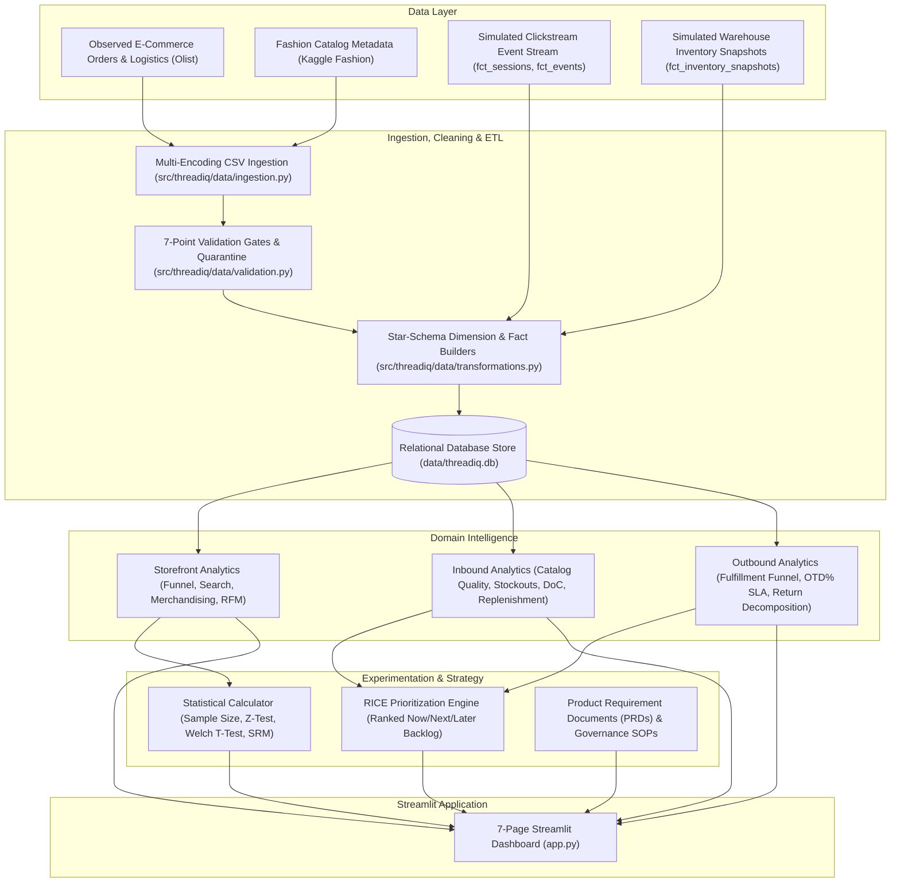

# ThreadIQ — Fashion Commerce Product Intelligence & Operations Platform

> **Turning commerce data into better product decisions.**

[](https://www.python.org/)
[](https://www.sqlalchemy.org/)
[](https://streamlit.io/)
[](file:///tests)
[](LICENSE)

---

## 1. Overview

**ThreadIQ** is an integrated product analytics and operational decision platform built specifically for fashion e-commerce.

In digital fashion commerce, commercial success depends on connecting top-of-funnel customer behavior with physical supply chain execution. When search fails to parse customer intent, shoppers bounce. When garment sizing is ambiguous, return rates surge and erode operating margins. When high-velocity styles run out of stock, revenue is permanently lost, while slow-moving inventory locks up working capital.

ThreadIQ was engineered to solve these interconnected challenges. It ingests transactional, catalog, behavioral, and logistics data, cleans and models it into a star-schema relational warehouse, computes domain-specific product metrics, and feeds those findings directly into an actionable product management framework comprising RICE prioritization, statistical A/B experimentation, and detailed Product Requirement Documents (PRDs).

---

## 2. Problem Statement

Modern e-commerce operators frequently make product decisions using siloed, fragmented metrics. Storefront teams optimize for clicks without visibility into post-purchase return rates; inventory managers reorder based on static thresholds without real-time promotional demand signals; and logistics teams treat carrier delays in isolation from customer order cancellations.

ThreadIQ addresses three specific operational bottlenecks:
1. **Storefront Conversion Leakage**: High cart abandonment (93.3%) and final checkout drop-off (89.0%), compounded by an 86.0% zero-result search rate when shoppers query natural fashion terminology.
2. **Inbound Sourcing & Inventory Imbalance**: High-velocity core listings operating at critical stockout risk (Days of Cover under 5 days) alongside stagnant listings exceeding 60 Days of Cover, while promotional campaigns rely heavily on margin-diluting flash sales.
3. **Outbound Logistics & Reverse Supply Chain Overhead**: Extended carrier transit times accounting for 75.2% of total order fulfillment latency, contributing to a 69.7% On-Time Delivery Rate (OTD%) and an elevated 23.2% apparel return rate heavily driven by sizing and fit mismatches (38.5% of returns).

---

## 3. Key Capabilities

### A. Storefront Intelligence
- **Conversion Funnel Deconstruction**: 6-stage session tracking from Homepage Impression to Purchase Completed, calculating step-by-step conversion and drop-off rates.
- **Cart & Checkout Abandonment Telemetry**: Quantifies drop-off between cart addition and payment authorization.
- **Search & Discovery Diagnostics**: Audits search query volume, click-through rates (CTR), zero-result search rates, and search-to-purchase conversion.
- **SKU & Category Commercial Velocity**: Measures views, add-to-cart rates, purchase conversion, gross revenue, and average selling price (ASP).
- **Customer Lifetime Analytics**: Repeat purchase rates, average order value (AOV), monthly cohort retention decay, and RFM behavioral segmentation.

### B. Inbound Intelligence
- **Catalog Completeness & Attribute Governance**: Audits mandatory merchandising fields (`article_type`, `sub_category`, `base_colour`, `season`, `usage`) with data quality scoring.
- **Inventory Availability & Health**: Daily SKU-level in-stock rates, stockout frequency, and trailing 30-day sales velocity.
- **Days of Cover (DoC) Diagnostics**: Identifies fast movers at risk of depletion versus overstocked styles.
- **Heuristic Replenishment Engine**: Suggests automated purchase order reorder quantities targeting a 30-day safety buffer, with documented urgency classification rules.
- **Pricing & Promotion Audits**: Non-parametric price quartiles by category, average promotional markdown depth, and campaign type distribution.

### C. Outbound Intelligence
- **Fulfillment Lifecycle Funnel**: Monitors orders through Placed, Approved, Dispatched, Delivered, and Canceled states.
- **Carrier SLA & Delivery Compliance**: Measures On-Time Delivery Rate (OTD%), late delivery rates, and regional state delivery performance.
- **Order Cancellation Diagnostics**: Tracks pre-fulfillment cancellation rates and operational correlations.
- **Fashion Return Decomposition**: Deconstructs apparel returns into root causes (`SIZE_FIT`, `STYLE_NOT_AS_PICTURED`, `QUALITY_FABRIC`, `LOGISTICS_DELAY`) and category return patterns (e.g. Activewear at 60%).
- **Fulfillment Bottleneck Waterfall**: Separates order fulfillment latency into Merchant Fulfillment (Order-to-Dispatch) versus Carrier Transit (Dispatch-to-Delivery).

### D. Experimentation & Decision Intelligence
- **Statistical Power & Sample Size Calculator**: Computes required sample sizes per variant for proportions and continuous metrics using SciPy.
- **Rigorous Hypothesis Testing**: Two-proportion z-tests (pooled standard error, two-tailed p-values, 95% confidence intervals) and Welch's independent t-tests for monetary spend (AOV).
- **Sample Ratio Mismatch (SRM) Detection**: Pearson Chi-Square goodness-of-fit testing ($\alpha = 0.001$) to flag assignment bias.
- **RICE Prioritization Framework**: Mathematical scoring ($\text{Reach} \times \text{Impact} \times \text{Confidence} / \text{Effort}$) ranking backlog initiatives into Now, Next, and Later execution horizons.

### E. Executive Dashboard
- Unified 7-page interactive Streamlit application powered by Plotly visualizations, responsive metric cards, and live database queries.

---

## 4. Technical Architecture



---

## 5. Technology Stack

- **Runtime & Core Language**: Python 3.13
- **Data Manipulation & Analysis**: Pandas, NumPy
- **Scientific Computing & Statistics**: SciPy 1.15.3, Statsmodels 0.14.4
- **Database & Object-Relational Mapping**: SQLite 3, SQLAlchemy 2.0
- **Interactive Presentation**: Streamlit 1.45.1, Plotly Express & Graph Objects 5.24.1
- **Testing & Verification**: Pytest 8.3.4, Streamlit AppTest harness
- **Environment & Utilities**: python-dotenv, tabulate

---

## 6. Data Sources & Provenance

ThreadIQ maintains strict data provenance labels across all records and calculations:

| Source Name | Type | Origin | Licence | Scope |
| :--- | :---: | :--- | :--- | :--- |
| **Brazilian E-Commerce Dataset** | `[OBSERVED]` | Olist / Kaggle | CC BY-NC-SA 4.0 | Order lifecycles, delivery timestamps, customer states, payment transactions. |
| **Fashion Product Images Dataset** | `[OBSERVED]` | Param Aggarwal / Kaggle | CC0: Public Domain | Apparel catalog hierarchy, colors, article types, product display names. |
| **Behavioral Clickstream Stream** | `[SYNTHETIC]` | ThreadIQ Synthetic Engine | Proprietary Simulated | Monotonically sequenced 6-stage user sessions, search queries, cart additions. |
| **Daily Inventory Snapshots** | `[SYNTHETIC]` | ThreadIQ Synthetic Engine | Proprietary Simulated | Daily warehouse stock, reservations, trailing velocity, demand archetypes. |
| **Promotional Schedules** | `[SYNTHETIC]` | ThreadIQ Synthetic Engine | Proprietary Simulated | Campaign schedules, discount depths, promotion types. |

> **Note on Simulated Data**: Public e-commerce datasets do not include raw clickstream logs or daily warehouse inventory snapshots. ThreadIQ generates these using a reproducible stochastic simulation engine (`src/threadiq/data/synthetic.py`). All synthetic tables carry explicit `source_type = 'synthetic'` attributes to maintain full audit transparency.

---

## 7. Key Analytical Findings & Product Insights

From the implemented analytics running against the populated database:

1. **Cart & Checkout Drop-off**: 93.25% of shopping sessions with an item added to cart fail to convert, with an 89.02% drop-off between checkout initiation and payment completion.
2. **Search Vocabulary Mismatch**: 85.96% of customer search queries return zero catalog results due to exact-string matching constraints on colloquial fashion terminology (e.g. "sneakers", "kimono").
3. **Inventory Days of Cover Skew**: Hero SKU 1101 operates at 4.2 Days of Cover, requiring an urgent reorder of 340 units, while tail listings exceed 60 Days of Cover.
4. **Logistics Bottleneck in Carrier Transit**: Carrier transit accounts for 75.15% of total order fulfillment lead time (171.2 hours vs. 56.7 hours for merchant dispatch), leading to an On-Time Delivery Rate of 69.70%.
5. **Reverse Logistics Driven by Size & Fit**: Apparel item return rate is 23.21%, with Size & Fit accounting for 38.46% of all returns and Activewear reaching a 60.00% category return rate.

---

## 8. Product Management Framework

ThreadIQ bridges quantitative analysis with product execution:

1. **RICE Backlog Prioritization**: All candidate initiatives are scored using explicit rubrics for Reach ($R$), Impact ($I$), Confidence ($C$), and Effort ($E$). Top-ranked initiatives:
   - `OPT-01`: **Digital Fit & Sizing Intelligence Engine** (RICE: 27,000 — Tier: **NOW**)
   - `OPT-02`: **1-Click Express Checkout & Digital Wallets** (RICE: 25,500 — Tier: **NOW**)
   - `OPT-03`: **Semantic Search & Dynamic Synonym Expansion** (RICE: 16,000 — Tier: **NOW**)
   - `OPT-04`: **Dynamic Days of Cover Replenishment Alerts** (RICE: 14,400 — Tier: **NOW**)
2. **Statistical Experimentation (A/B Testing)**: Evaluates pre-registered hypotheses with power sizing, two-proportion z-tests, Welch's t-tests, and Sample Ratio Mismatch (SRM) checks.
3. **Enterprise Product Requirement Documents (PRDs)**: 15-section specifications covering overview, problem statement, user personas, pain points, goals/non-goals, solution, user stories, functional/non-functional requirements, user journey, acceptance criteria, success metrics, dependencies, risks, and rollout plan.
4. **Product Operations & Governance**: Defect triage SOP (P0–P3), customer feedback taxonomy, release checklists, QA handover matrices, Product Decision Records (PDRs), and active risk trackers.

---

## 9. Project Structure

```text
threadiq/
├── .streamlit/
│   └── config.toml                           # Streamlit configuration and theme
├── data/
│   ├── threadiq.db                           # Star-schema SQLite database
│   ├── raw/                                  # Raw dataset staging
│   ├── processed/                            # Validated parquet/csv tables
│   └── synthetic/                            # Generated behavioral event logs
├── docs/
│   ├── architecture/                         # System architecture, schemas, pipeline specs
│   ├── data/                                 # Data dictionary, quality report, methodology
│   ├── analytics/                            # Storefront, inbound, outbound, metrics dictionary
│   ├── product/                              # Strategy, insights, RICE backlog, roadmap
│   ├── experimentation/                      # Statistical methodology & trial results
│   ├── prd/                                  # Production PRDs (01, 02, 03)
│   ├── operations/                           # SOPs, feedback framework, checklists, decision log
│   └── quality/                              # Requirements audit, testing report, integration audit
├── src/
│   └── threadiq/
│       ├── analytics/                        # 14 Modular analytics calculation classes
│       │   ├── common/                       # Base analytics & MetricResult dataclass
│       │   ├── storefront/                   # Funnel, Search, Merchandising, Cohorts/RFM
│       │   ├── inbound/                      # Catalog quality, Inventory, DoC, Replenishment
│       │   └── outbound/                     # Fulfillment, Delivery SLA, Return reasons, Waterfall
│       ├── experimentation/                  # A/B testing calculator, RICE prioritizer, Simulator
│       ├── data/                             # Ingestion, validation, cleaning, loaders, pipeline
│       └── dashboard/                        # Presentation & visualization layer
│           ├── theme.py                      # Custom CSS, Plotly templates, metric cards
│           └── pages/                        # 7 Presentation modules
├── tests/                                    # 54 Automated pytest test cases
│   ├── test_analytics.py                     # Analytics modules & edge cases (14 tests)
│   ├── test_cleaning.py                      # Quarantine & cleaning tests (3 tests)
│   ├── test_dashboard.py                     # Dashboard imports, theme & AppTest (5 tests)
│   ├── test_experimentation.py               # Power, z-tests, t-tests, RICE (12 tests)
│   ├── test_ingestion.py                     # Multi-encoding CSV reading (5 tests)
│   ├── test_loaders_and_pipeline.py          # Database loads & migrations (2 tests)
│   ├── test_synthetic_data.py                # Behavioral simulation checks (7 tests)
│   └── test_validation.py                    # Quality gates & referential integrity (6 tests)
├── app.py                                    # Main Streamlit web application entrypoint
├── requirements.txt                          # Pinned project dependencies
├── sofar.md                                  # Cumulative progress tracking ledger
└── README.md                                 # Project documentation
```

---

## 10. Installation and Setup

### Prerequisites
- Python 3.11, 3.12, or 3.13
- Git

### 1. Clone the Repository
```bash
git clone https://github.com/PrinceNsut27/ThreadIQ.git
cd ThreadIQ
```

### 2. Set Up Virtual Environment
```bash
# Windows (PowerShell):
python -m venv venv
venv\Scripts\Activate.ps1

# macOS / Linux:
python3 -m venv venv
source venv/bin/activate
```

### 3. Install Dependencies
```bash
pip install --upgrade pip
pip install -r requirements.txt
```

### 4. Configure Environment Variables
```bash
# Copy the example environment template
cp .env.example .env
```
*(Default settings connect automatically to `sqlite:///data/threadiq.db` without external credentials).*

### 5. Initialize Database & Run Data Pipeline
Populate the SQLite relational database with seed tables, catalog metadata, and synthetic clickstream/inventory snapshots:
```bash
python scripts/run_pipeline.py --mock-if-missing --recreate-db
```

---

## 11. Run the Dashboard

Launch the interactive Streamlit application:
```bash
streamlit run app.py
```
Open your browser to `http://localhost:8501`.

### Dashboard Navigation:
- **Executive Overview**: High-level GMV, orders, unique customers, OTD% SLA, and fulfillment status distribution.
- **Storefront Intelligence**: Full-funnel progression, cart/checkout abandonment, popular search queries, and RFM customer segmentation.
- **Inbound Intelligence**: Catalog completeness scoring (97.2%), stockout frequency, Days of Cover, urgent replenishment POs, and pricing quartiles.
- **Outbound Intelligence**: Delivery SLA compliance, regional state transit performance, fashion return reasons (`SIZE_FIT` = 38.5%), and merchant vs. carrier bottleneck waterfall.
- **A/B Experimentation**: Statistical trial metrics, interactive sample size calculator, and custom two-proportion hypothesis tester.
- **Product Roadmap & RICE**: Ranked backlog with RICE scores, Now/Next/Later filters, Gantt timeline, and risk log.
- **Strategic Insights & PRDs**: 15 evidence-backed product opportunities with verified metrics and links to PRDs.

---

## 12. Testing

Run the full automated test suite using pytest:
```bash
pytest tests/ -v
```

### Test Coverage Summary:
- **54 total test cases across 8 test suites** pass with 100% success.
- Includes unit tests for all 14 analytics classes, ingestion encoding fallbacks, data cleaning quarantine rules, database relational integrity, statistical power calculations, z-tests, Welch's t-tests, RICE scoring, and native headless Streamlit `AppTest` execution across all 7 dashboard pages with 0 unhandled exceptions.

---

## 13. Limitations

1. **Synthetic Behavioral Data**: Public e-commerce datasets do not include raw digital clickstream sessions or daily warehouse inventory snapshots. ThreadIQ generates these using a stochastic simulation engine (`src/threadiq/data/synthetic.py`). All synthetic tables carry explicit `source_type = 'synthetic'` tags.
2. **Local SQLite Concurrency**: SQLite is utilized as the default embedded relational database for portability. In enterprise production deployments with high concurrent write volume, the SQLAlchemy abstraction layer allows configuring PostgreSQL by updating `DATABASE_URL` in `.env`.
3. **Simulated A/B Experiments**: Trial results in Page 5 are simulated cohorts designed to demonstrate statistical power analysis, confidence intervals, and Sample Ratio Mismatch checks. They represent decision-support methodology rather than live production causal proof.

---

## 14. Future Improvements

- **3D Virtual Try-On Integration**: Computer-vision powered augmented reality sizing widget for complex categories (`OPT-10`).
- **Distributed Streaming Ingestion**: Integration with Apache Kafka or AWS Kinesis for real-time sub-second clickstream processing.
- **Dynamic Multi-Carrier API Integration**: Automated carrier switching based on live destination route congestion webhooks (`OPT-05`).
- **LLM Review Mining**: Automated natural language clustering of customer review comments (`fct_order_reviews`) into actionable garment construction defect alerts.

---

## 15. Project Information

**ThreadIQ** is an independent educational and portfolio project developed by **PrinceNsut27**. It is not affiliated with Myntra and does not use Myntra's internal datasets or systems. All public datasets are used under their respective open-access licences.
