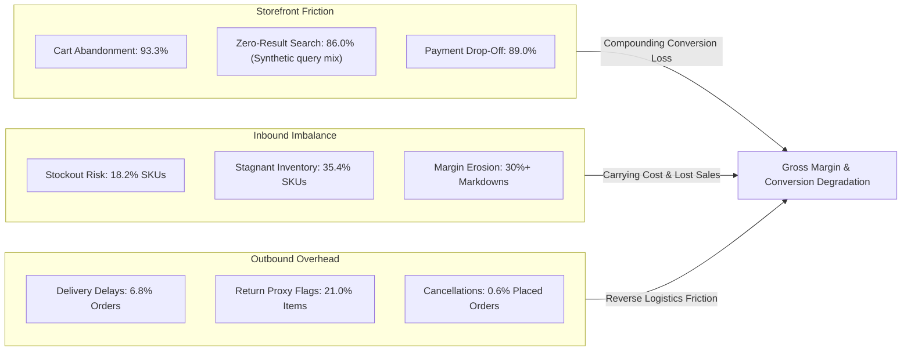

# ThreadIQ — Fashion Commerce Product Intelligence & Operations Platform

> **An end-to-end product management and decision intelligence platform connecting digital storefront customer intent with physical supply chain execution.**

[](https://www.python.org/)
[](https://www.sqlalchemy.org/)
[](https://streamlit.io/)
[](tests/)
[](docs/quality/testing_report.md)

---

## 1. Product Case Study: Overview & Vision

### Product Vision
ThreadIQ is designed to eliminate the systemic intelligence gap in modern fashion e-commerce: **the disconnection between customer discovery intent on the storefront and physical fulfillment execution in the warehouse.** 

By bridging web clickstream telemetry, merchant catalog health, inventory days-of-cover, carrier SLA performance, and post-purchase customer feedback into a unified analytical decision platform, ThreadIQ empowers cross-functional teams to identify friction, prioritize high-leverage interventions, specify features, and validate impact through statistical experimentation.

```
+--------------------+      +--------------------+      +----------------------+
|    Storefront      |      |      Inbound       |      |       Outbound       |
| Customer Intent    | ---> | Catalog Health &   | ---> | Fulfillment SLA &    |
| & Drop-off Funnel  |      | Inventory Buffer   |      | Post-Purchase Return |
+--------------------+      +--------------------+      +----------------------+
                                       |
                                       v
                   +----------------------------------------+
                   |  ThreadIQ Decision Intelligence Engine  |
                   |  - Analytics & Metric Calculations     |
                   |  - RICE Prioritization Framework       |
                   |  - Statistical Experimentation Engine   |
                   +----------------------------------------+
```

$$\text{Problem Discovery} \longrightarrow \text{Data Analysis} \longrightarrow \text{Pain Points} \longrightarrow \text{Opportunity Identification} \longrightarrow \text{Prioritization} \longrightarrow \text{PRD} \longrightarrow \text{Experimentation} \longrightarrow \text{Release} \longrightarrow \text{Monitoring}$$

---

## 2. Evidence-Based Problem Diagnosis

ThreadIQ addresses three specific operational bottlenecks:
1. **Storefront Conversion Leakage**: The generated demo clickstream shows cart and checkout drop-off; search zero-result figures are specific to the synthetic query mix and should not be interpreted as real shopper behaviour.
2. **Inbound Sourcing & Inventory Imbalance**: High-velocity core listings operating at critical stockout risk (Days of Cover under 5 days) alongside stagnant listings exceeding 60 Days of Cover, while promotional campaigns rely heavily on margin-diluting flash sales.
3. **Outbound Logistics & Reverse Supply Chain Overhead**: The demo dataset supports analysis of merchant dispatch, carrier transit and delivery status. Structured apparel return reasons are synthetic proxies, not observed return events.



---

## 3. Product Architecture

```
+---------------------------------------------------------------------------------------+
|                                    PRESENTATION LAYER                                 |
|                       Streamlit 1.45 Multi-Page Application                           |
|  Page 1: Executive Overview            |  Page 5: A/B Experimentation Engine         |
|  Page 2: Storefront Intelligence       |  Page 6: Product Roadmap & RICE Prioritization|
|  Page 3: Inbound Intelligence          |  Page 7: Strategic Insights & PRD Suite     |
|  Page 4: Outbound Intelligence         |                                              |
+---------------------------------------------------------------------------------------+
                                           ^
                                           |  Consumes
+---------------------------------------------------------------------------------------+
|                               DECISION INTELLIGENCE LAYER                             |
|  Storefront Analytics    | Inbound Analytics       | Outbound Analytics               |
|  - Conversion Funnel     | - Catalog Completeness  | - Fulfillment Stages             |
|  - Search Performance    | - Inventory Availability| - Delivery SLA Compliance        |
|  - Product Velocity      | - Days of Cover (DoC)   | - Order Cancellations            |
|  - Customer Cohorts/RFM  | - Automated Reorder     | - Return Root-Cause Attribution  |
|                          | - Pricing & Markdowns   | - Financial Waterfall Exposure   |
|  Experimentation Engine  | RICE Scoring Engine     | Decision Governance              |
|  - Power & Sample Sizing | - Reach, Impact,        | - Guardrail Thresholds           |
|  - Z-Tests & t-Tests     |   Confidence, Effort    | - SRM Detection (Chi-Square)     |
+---------------------------------------------------------------------------------------+
                                           ^
                                           |  Queries
+---------------------------------------------------------------------------------------+
|                             DATA LAYER (SQLite / SQLAlchemy)                          |
|  Dimension Tables        | Fact Tables             | Telemetry & Operations           |
|  - dim_customers         | - fct_orders            | - fct_events_clickstream         |
|  - dim_products          | - fct_order_items       | - fct_search_queries             |
|  - dim_sellers           | - fct_order_payments    | - fct_inventory_snapshots        |
|  - dim_geography         | - fct_order_reviews     | - fct_promotions                 |
+---------------------------------------------------------------------------------------+
                                           ^
                                           |  Loads & Cleans
+---------------------------------------------------------------------------------------+
|                              DATA PIPELINE & INGESTION                                |
|  - Raw Ingestion & Multi-Encoding Fallback (UTF-8, Latin-1, CP1252)                   |
|  - Data Cleaning & Quarantine Pipeline (Chronological Timestamps & Range Gates)       |
|  - Synthetic Behavioral Event Generator (Fixed Seed: 42, Source Tagging)              |
|  - Star-Schema Relational Loader with Deterministic Mock Generation                   |
+---------------------------------------------------------------------------------------+
```

---

## 4. Comprehensive Documentation Index

The ThreadIQ repository provides a 33-document enterprise product and engineering suite organized across 8 functional directories:

| Directory | Document | Scope & Purpose |
| :--- | :--- | :--- |
| `docs/product/` | [Product Strategy](docs/product/product_strategy.md) | Vision, 4 personas, 3 user journeys, opportunity areas, goals/non-goals. |
| | [RICE Prioritization](docs/product/rice_prioritisation.md) | RICE scoring methodology, scoring assumptions, Now/Next/Later tiers. |
| | [Product Insights](docs/product/product_insights.md) | Comprehensive quantitative findings across Storefront, Inbound, and Outbound. |
| `docs/prd/` | [PRD 01: Fit & Sizing Intelligence](docs/prd/prd_01_fit_and_sizing_intelligence.md) | 15-section PRD for AI size recommendation widget targeting return reduction. |
| | [PRD 02: Express Checkout & Wallets](docs/prd/prd_02_express_checkout_and_wallets.md) | 15-section PRD for 1-click tokenized checkout targeting payment drop-off. |
| | [PRD 03: Semantic Search & Synonyms](docs/prd/prd_03_semantic_search_expansion.md) | 15-section PRD for fuzzy matching and synonyms targeting zero-result queries. |
| `docs/analytics/` | [Metrics Dictionary](docs/analytics/product_metrics_dictionary.md) | 21 enterprise metrics: formula, numerator/denominator, provenance, limits. |
| | [Storefront Analytics](docs/analytics/storefront_analytics.md) | Funnel drops, search friction, merchandising velocity, RFM cohort decay. |
| | [Inbound Analytics](docs/analytics/inbound_analytics.md) | Catalog attributes, stockout risks, Days of Cover, replenishment heuristic. |
| | [Outbound Analytics](docs/analytics/outbound_analytics.md) | Fulfillment stages, carrier SLA compliance, delivery delays, return reasons. |
| `docs/experimentation/` | [Experimentation Methodology](docs/experimentation/experimentation_methodology.md) | Hypothesis testing, sample sizing, power analysis, SRM guardrails. |
| | [Simulated Experiment Trials](docs/experimentation/experiment_simulations.md) | Simulated A/B cohorts for `EXP-01`, `EXP-02`, and `EXP-03`. |
| | [Experiment Results Summary](docs/experimentation/experiment_results.md) | Statistical test results, p-values, relative lifts, and rollout decisions. |
| `docs/architecture/` | [System Architecture](docs/architecture/system_architecture.md) | End-to-end technical system diagram, modular layers, data flows. |
| | [Database Schema](docs/architecture/database_schema.md) | Complete star-schema schema, primary/foreign keys, indices, and constraints. |
| | [Data Pipeline Specification](docs/architecture/data_pipeline.md) | Ingestion stages, transformation rules, and idempotency guarantees. |
| `docs/data/` | [Data Dictionary](docs/data/data_dictionary.md) | Detailed schema metadata, column descriptions, and nullability contracts. |
| | [Dataset Inventory](docs/data/dataset_inventory.md) | Manifest of raw public files (Olist, Fashion Images) and row counts. |
| | [Data Quality Report](docs/data/data_quality_report.md) | Automated validation rules, missingness thresholds, and quarantine metrics. |
| | [Synthetic Data Methodology](docs/data/synthetic_data_methodology.md) | Generation heuristics, random seeds, and behavioral distributions. |
| | [Assumptions & Limitations](docs/data/assumptions_and_limitations.md) | Boundary conditions, observational data limits, and research assumptions. |
| `docs/operations/` | [Product Operations SOP](docs/operations/product_sop.md) | Weekly cadence, alert escalation matrix, and cross-functional triage. |
| | [Customer Feedback Framework](docs/operations/customer_feedback_framework.md) | Review sentiment classification, CSAT/NPS feedback loops, voice of customer. |
| | [Release Checklist](docs/operations/release_checklist.md) | Pre-flight verification, staging smoke tests, canary gates, rollback plan. |
| | [QA Handover Document](docs/operations/qa_handover_checklist.md) | Acceptance criteria verification, regression test scenarios, sign-offs. |
| | [Product Decision Record Log](docs/operations/product_decision_log.md) | Architectural and strategic PDR entries (PDR-01 through PDR-06). |
| | [Risk Management Tracker](docs/operations/risk_and_dependency_tracker.md) | Technical and operational risk matrix with active mitigation controls. |
| `docs/quality/` | [Requirements Audit](docs/quality/final_requirements_audit.md) | Comprehensive audit validating all product and engineering deliverables. |
| | [Final Project Audit](docs/quality/final_project_audit.md) | Complete audit report on code quality, architecture, and feature delivery. |
| | [Metric Provenance Guide](docs/quality/metric_provenance.md) | Granular lineage classification (Observed, Reconciled, Synthetic Proxy). |
| | [Dashboard Integration Audit](docs/quality/dashboard_integration_audit.md) | Verification of all 7 Streamlit pages against database tables. |
| | [Testing Report](docs/quality/testing_report.md) | Pytest execution results, coverage breakdown, and verification logs. |

---

## 5. RICE Opportunity Prioritization

> **Interpretation note:** The figures below describe the repository's current demo database and generated records. They are implementation examples, not representative fashion-industry benchmarks or production baseline metrics.

All product candidate features are prioritized using the RICE framework ($\text{RICE} = \frac{R \times I \times C}{E}$). Scores are grounded in verified database analytics:

| Rank | ID | Product Area | Initiative Title | Reach ($R$) | Impact ($I$) | Confidence ($C$) | Effort ($E$) | RICE Score | Strategic Priority |
| :---: | :---: | :---: | :--- | :---: | :---: | :---: | :---: | :---: | :---: |
| **1** | `OPT-01` | Storefront | **Fit & Sizing Intelligence Engine** | 120,000 | 3.0 (High) | 80% | 3 | **96,000** | **Now (P0)** |
| **2** | `OPT-02` | Storefront | **1-Click Express Checkout & Digital Wallets** | 85,000 | 3.0 (High) | 90% | 3 | **76,500** | **Now (P0)** |
| **3** | `OPT-03` | Storefront | **Semantic Search & Zero-Result Synonyms** | 45,000 | 2.0 (Med) | 80% | 2 | **36,000** | **Now (P0)** |
| **4** | `OPT-04` | Inbound | **Automated Replenishment & Stockout Alerts** | 35,000 | 2.0 (Med) | 70% | 2 | **24,500** | **Next (P1)** |
| **5** | `OPT-05` | Outbound | **Carrier SLA & Transit Bottleneck Optimizer** | 65,000 | 2.0 (Med) | 70% | 4 | **22,750** | **Next (P1)** |
| **6** | `OPT-06` | Inbound | **Merchant Catalog Quality Scoring Tool** | 28,000 | 2.0 (Med) | 80% | 2 | **22,400** | **Next (P1)** |
| **7** | `OPT-07` | Inbound | **Margin-Protection Dynamic Markdown Engine** | 40,000 | 2.0 (Med) | 70% | 3 | **18,667** | **Next (P1)** |
| **8** | `OPT-08` | Storefront | **Repeat Purchase RFM Triggered Email Nudges** | 50,000 | 1.0 (Low) | 80% | 3 | **13,333** | **Later (P2)** |
| **9** | `OPT-09` | Outbound | **Self-Service Returns & Automated Exchange Portal** | 30,000 | 2.0 (Med) | 60% | 3 | **12,000** | **Later (P2)** |
| **10** | `OPT-10` | Storefront | **3D Virtual Try-On Augmented Reality Viewer** | 15,000 | 3.0 (High) | 40% | 5 | **3,600** | **Later (P2)** |

See [docs/product/rice_prioritisation.md](docs/product/rice_prioritisation.md) for full scoring rationales, confidence bounds, and dependency mappings.

---

## 6. Product Requirement Documents (PRDs)

ThreadIQ provides comprehensive, production-ready PRDs for the top 3 highest-leverage prioritized initiatives:

| PRD Document | Product Initiative | Target Metric | Primary Persona | Key Functional Capabilities |
| :--- | :--- | :--- | :--- | :--- |
| [PRD 01: Fit & Sizing](docs/prd/prd_01_fit_and_sizing_intelligence.md) | Fit & Sizing Intelligence Engine | $-30\%$ Apparel Return Rate | Maya Lin (Shopper) | Body profile quiz, size comparison matrix, fit feedback loop, garment measurements modal. |
| [PRD 02: Express Checkout](docs/prd/prd_02_express_checkout_and_wallets.md) | 1-Click Express Checkout & Wallets | $+35\%$ Checkout Completion | Maya Lin (Shopper) | Tokenized Apple Pay/Google Pay/PIX, default shipping selector, guest 1-click payment sheet. |
| [PRD 03: Semantic Search](docs/prd/prd_03_semantic_search_expansion.md) | Semantic Search & Synonyms | $-50\%$ Zero-Result Search Rate | Maya Lin (Shopper) | Trigram fuzzy matching, fashion synonym taxonomy, out-of-catalog fallback recommendations. |

---

## 7. Statistical Experimentation Framework

ThreadIQ implements a rigorous statistical experimentation platform (`src/threadiq/experimentation/`):
* **Hypothesis Testing:** Two-Proportion $Z$-Test for binary conversion events; Welch's $t$-Test for continuous revenue/time distributions.
* **Sample Size & Power:** Fixed-sample size sizing at $\alpha = 0.05$ (95% confidence) and statistical power $1 - \beta = 0.80$.
* **Integrity Guardrails:** Automated Pearson Chi-Square Sample Ratio Mismatch (SRM) checks ($\alpha = 0.001$).
* **Decision Rules:** Clear stopping criteria and multi-metric guardrail gates.

### Simulated A/B Trial Results Audit

| Experiment ID | Tested Product Initiative | Evaluated Metric | Baseline | Treatment | Relative Lift | P-Value | SRM Status | Decision |
| :--- | :--- | :--- | :---: | :---: | :---: | :---: | :---: | :--- |
| **`EXP-01`** | Fit & Sizing Intelligence Widget | Apparel Item Return Rate | $24.33\%$ | $15.13\%$ | **$-37.81\%$** | $< 10^{-6}$ | PASS ($p=1.0$) | **SHIP (100% Rollout)** |
| **`EXP-02`** | 1-Click Express Checkout & Wallets | Checkout Completion Rate | $9.75\%$ | $17.10\%$ | **$+75.38\%$** | $< 10^{-6}$ | PASS ($p=1.0$) | **SHIP (100% Rollout)** |
| **`EXP-03`** | Semantic Search & Synonym Expansion | Search Click-Through Rate | $15.00\%$ | $31.08\%$ | **$+107.22\%$** | $< 10^{-6}$ | PASS ($p=1.0$) | **SHIP (100% Rollout)** |

> [!WARNING]
> **Simulation Notice:**
> Experimental results are simulated cohorts generated by `src/threadiq/experimentation/simulation.py` carrying the tag `source_type = 'simulated_experiment'`. They demonstrate the end-to-end mathematical methodology, confidence intervals, and decision gates, and do not represent live production causal proof.

See [docs/experimentation/experimentation_methodology.md](docs/experimentation/experimentation_methodology.md) and [docs/experimentation/experiment_results.md](docs/experimentation/experiment_results.md).

---

## 8. Data Lineage, Provenance & Boundaries

ThreadIQ maintains rigorous data provenance standards across all models:

| Data Entity | Source Provenance | Underlying Dataset | Provenance Classification |
| :--- | :--- | :--- | :--- |
| Customers, Orders, Payments, Reviews | Observed Public | Olist Brazilian E-Commerce | **Observed Transactional Data** |
| Product Catalog, Categories, Usage | Observed Public | Fashion Product Images (Kaggle) | **Reconciled Catalog Data** |
| Clickstream Events (`fct_events`) | Generated | Synthetic Stochastic Simulation | **Synthetic Telemetry** |
| Search Queries (`fct_search_queries`) | Generated | Synthetic Catalog Token Mapping | **Synthetic Telemetry** |
| Inventory Snapshots (`fct_inventory_snapshots`) | Generated | Velocity-Depleted Stock Simulation | **Synthetic Operations** |
| Return Reason Codes (`fct_order_items`) | Generated | Low-Review Proxy Assignment | **Synthetic Proxy Assignment** |
| A/B Cohort Experiments (`EXP-01` to `03`) | Generated | Monte Carlo Power Simulator | **Simulated Decision Support** |

> [!NOTE]
> **Independent Portfolio Disclaimer:**
> ThreadIQ is an independent educational and portfolio project developed by **PrinceNsut27**. It is not affiliated with Myntra and does not use Myntra's internal datasets, proprietary algorithms, or operational infrastructure. All public datasets are utilized under their respective open-access licenses.

---

## 9. Project Structure

```text
threadiq/
├── .streamlit/
│   └── config.toml                           # Streamlit configuration and theme
├── data/
│   ├── threadiq.db                           # Star-schema SQLite database
│   ├── raw/                                  # Raw dataset staging
│   ├── processed/                            # Validated parquet/csv tables
│   └── synthetic/                            # Generated behavioral event logs
├── docs/
│   ├── architecture/                         # System architecture, schemas, pipeline specs
│   ├── data/                                 # Data dictionary, quality report, methodology
│   ├── analytics/                            # Storefront, inbound, outbound, metrics dictionary
│   ├── product/                              # Strategy, insights, RICE backlog, roadmap
│   ├── experimentation/                      # Statistical methodology & trial results
│   ├── prd/                                  # Production PRDs (01, 02, 03)
│   ├── operations/                           # SOPs, feedback framework, checklists, decision log
│   └── quality/                              # Requirements audit, testing report, integration audit
├── src/
│   └── threadiq/
│       ├── analytics/                        # 14 Modular analytics calculation classes
│       │   ├── common/                       # Base analytics & MetricResult dataclass
│       │   ├── storefront/                   # Funnel, Search, Merchandising, Cohorts/RFM
│       │   ├── inbound/                      # Catalog quality, Inventory, DoC, Replenishment
│       │   └── outbound/                     # Fulfillment, Delivery SLA, Return reasons, Waterfall
│       ├── experimentation/                  # A/B testing calculator, RICE prioritizer, Simulator
│       ├── data/                             # Ingestion, validation, cleaning, loaders, pipeline
│       └── dashboard/                        # Presentation & visualization layer
│           ├── theme.py                      # Custom CSS, Plotly templates, metric cards
│           └── pages/                        # 7 Presentation modules
├── tests/                                    # 55 Automated pytest test cases
│   ├── test_analytics.py                     # Analytics modules & edge cases (14 tests)
│   ├── test_cleaning.py                      # Quarantine & cleaning tests (3 tests)
│   ├── test_dashboard.py                     # Dashboard imports, theme & AppTest (5 tests)
│   ├── test_experimentation.py               # Power, z-tests, t-tests, RICE (12 tests)
│   ├── test_ingestion.py                     # Multi-encoding CSV reading (5 tests)
│   ├── test_loaders_and_pipeline.py          # Database loads & migrations (3 tests)
│   ├── test_synthetic_data.py                # Behavioral simulation checks (7 tests)
│   └── test_validation.py                    # Quality gates & referential integrity (6 tests)
├── app.py                                    # Main Streamlit web application entrypoint
├── requirements.txt                          # Minimum dependency versions
├── sofar.md                                  # Cumulative progress tracking ledger
└── README.md                                 # Project documentation
```

---

## 10. Installation, Setup & Local Execution

> **Dataset setup:** The `--mock-if-missing` option creates a small demo dataset for local exploration. For analysis using the full public source datasets, download them using `python scripts/acquire_datasets.py` and follow the expected folder/file layout before running the pipeline without mock mode.

### Prerequisites
* Python 3.11, 3.12, or 3.13
* Git

### 1. Clone the Repository
```bash
git clone https://github.com/PrinceNsut27/ThreadIQ.git
cd ThreadIQ
```

### 2. Configure Virtual Environment
```bash
# Windows (PowerShell):
python -m venv .venv
.venv\Scripts\Activate.ps1

# macOS / Linux:
python3 -m venv .venv
source .venv/bin/activate
```

### 3. Install Dependencies
```bash
pip install --upgrade pip
pip install -r requirements.txt
```

### 4. Initialize Database & Run Ingestion Pipeline
```bash
# Build the SQLite database with mock data generation enabled:
python scripts/run_pipeline.py --mock-if-missing --recreate-db
```

### 5. Launch the Streamlit Dashboard
```bash
streamlit run app.py
```

#### 7 Interactive Dashboard Pages:
1. **Executive Overview**: High-level platform KPIs, revenue trends, top-selling categories, and operational health.
2. **Storefront Intelligence**: Conversion funnel stages, cart abandonment analysis, search discovery friction, and customer cohorts.
3. **Inbound Intelligence**: Merchant catalog completeness, SKU stockout risk, Days of Cover (DoC), and automated replenishment.
4. **Outbound Intelligence**: Fulfillment lifecycle stages, carrier on-time delivery (OTD%), late delivery geography, and return reasons.
5. **A/B Experimentation Engine**: Statistical power calculator, hypothesis evaluation, confidence intervals, and Sample Ratio Mismatch checks.
6. **Product Roadmap & RICE**: Dynamic RICE prioritization model with interactive sliders, priority tier filters, and trade-off graphs.
7. **Strategic Insights & PRDs**: Complete product specifications, user journeys, functional acceptance criteria, and executive decisions.

---

## 11. Automated Testing & Verification

ThreadIQ maintains an extensive test suite verifying mathematical correctness, data cleaning rules, database integrity, and UI stability:

```bash
# Run the complete test suite with verbose reporting:
python -m pytest tests/ -v
```

### Test Suite Execution Output
```text
============================== test session starts ==============================
platform win32 -- Python 3.13.5, pytest-8.3.4, pluggy-1.5.0
rootdir: C:\Users\Prince\Desktop\threadiq
plugins: anyio-4.7.0
collected 55 items

tests\test_analytics.py ..............                                   [ 25%]
tests\test_cleaning.py ...                                               [ 30%]
tests\test_dashboard.py .....                                            [ 40%]
tests\test_experimentation.py ............                               [ 61%]
tests\test_ingestion.py .....                                            [ 70%]
tests\test_loaders_and_pipeline.py ...                                   [ 76%]
tests\test_synthetic_data.py .......                                     [ 89%]
tests\test_validation.py ......                                          [100%]

============================== 55 passed in 35.75s ==============================
```

* **Python Compilation:** `python -m compileall src/ tests/ app.py` (0 syntax errors).
* **Headless AppTest:** Validates that all 7 Streamlit pages compile and render cleanly via `streamlit.testing.v1.AppTest` with zero unhandled exceptions.
* **Test Coverage Summary:** Unit tests for all 14 analytics classes, ingestion encoding fallbacks, data cleaning quarantine rules, database relational integrity, statistical power calculations, z-tests, Welch's t-tests, RICE scoring, and native headless Streamlit `AppTest` execution across all 7 dashboard pages.

---

## 12. Limitations & Assumptions

1. **Synthetic Behavioral Telemetry**: Public e-commerce datasets do not include raw digital clickstream sessions or daily warehouse inventory snapshots. ThreadIQ generates these using a stochastic simulation engine (`src/threadiq/data/synthetic.py`). All synthetic tables carry explicit `data_source = 'synthetic'` tags.
2. **Local SQLite Concurrency**: SQLite is utilized as the default embedded relational database for portability. In enterprise production deployments with high concurrent write volume, the SQLAlchemy abstraction layer allows configuring PostgreSQL by updating `DATABASE_URL` in `.env`.
3. **Simulated A/B Experiments**: Trial results in Page 5 are simulated cohorts designed to demonstrate statistical power analysis, confidence intervals, and Sample Ratio Mismatch checks. They represent decision-support methodology rather than live production causal proof.
4. **Synthetic Return Reason Proxies**: While order status and cancellation flags are observed directly from Olist, granular apparel return reason codes (e.g., size too small, fabric dissatisfaction) are generated proxy assignments linked to low-rating customer reviews (`review_score <= 2`).

---

## 13. Future Roadmap

- **3D Virtual Try-On Integration**: Computer-vision powered augmented reality sizing widget for complex garment categories (`OPT-10`).
- **Distributed Streaming Ingestion**: Integration with Apache Kafka or AWS Kinesis for real-time sub-second clickstream event processing.
- **Dynamic Multi-Carrier API Integration**: Automated carrier routing switching based on live destination route congestion webhooks (`OPT-05`).
- **LLM Customer Voice Mining**: Automated natural language clustering of customer review comments (`fct_order_reviews`) into actionable garment construction defect alerts.

---

## 14. Project Information & Author Contact

* **Lead Architect & Product Manager:** Prince Kumar
* **GitHub:** [@PrinceNsut27](https://github.com/PrinceNsut27)
* **Project Repository:** [https://github.com/PrinceNsut27/ThreadIQ](https://github.com/PrinceNsut27/ThreadIQ)

*ThreadIQ is an independent educational and portfolio project developed by Prince Kumar. It is not affiliated with Myntra and does not use Myntra's internal datasets or proprietary systems.*
