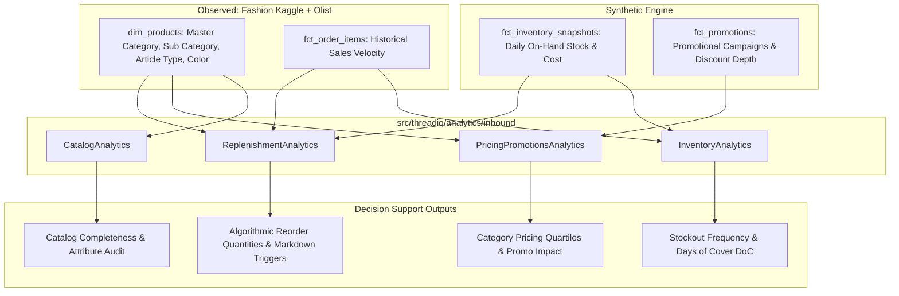

# Inbound Supply Chain Analytics Specification

## 1. Executive Summary & Objective

The **Inbound Supply Chain Analytics** module of ThreadIQ oversees inventory health, catalog integrity, supplier inbound readiness, and pricing strategies. 

In fashion e-commerce, inbound efficiency directly dictates storefront conversion: missing product descriptions prevent customer discovery, stockouts lead to lost sales and brand churn, and excessive inventory accumulation leads to severe terminal markdowns and working capital lockup.

Key operational objectives:
1. Audit catalog completeness, schema consistency, and product attribute health across all listed SKUs.
2. Monitor daily SKU-level inventory availability, stockout incidents, stockout duration, and Days of Cover (DoC).
3. Evaluate pricing structures, category price elasticity, promotional discount depth, and promotional margins.
4. Generate automated, algorithmic replenishment recommendations and markdown clearance flags for slow-moving inventory.

---

## 2. Architecture & Data Flow

> [!NOTE]
> **Data Provenance Distinction:**
> - Master product metadata (names, categories, base colors) originates from the Kaggle Fashion dataset (`data_source = 'fashion_kaggle'`).
> - Daily inventory snapshot logs (`fct_inventory_snapshots`) and promotional calendars (`fct_promotions`) are generated via the synthetic simulation engine (`source_type = 'synthetic'`).
> - Sales demand signals are calculated from verified order item transactions (`data_source = 'olist'`).

---

## 3. Catalog Quality & Completeness Analytics

### 3.1 Mandatory Attribute Audit
A fashion SKU requires comprehensive attribute metadata to support storefront faceted navigation, filtering, and search indexing. The analytics engine audits the completeness of five mandatory product attributes:
1. `article_type` (e.g., T-Shirts, Casual Shoes)
2. `sub_category` (e.g., Topwear, Footwear)
3. `base_colour` (e.g., Black, Navy Blue, Red)
4. `season` (e.g., Summer, Fall, Winter)
5. `usage` (e.g., Casual, Formal, Sports)

### 3.2 Catalog Completeness Score Methodology
For each product $j$, the catalog completeness score $S_j \in [0, 100]$ is calculated as:
$$S_j = \left( \frac{\sum_{k=1}^M \mathbb{I}(\text{attribute}_{j,k} \text{ is not null})}{M} \right) \times 100$$
where $M=5$ is the number of mandatory audit attributes.

The platform-wide catalog completeness score is the mean across all active items:
$$\bar{S}_{\text{catalog}} = \frac{1}{N} \sum_{j=1}^N S_j$$

Any SKU with $S_j < 100\%$ is flagged in the **Catalog Enrichment Priority Queue**.

---

## 4. Inventory Health & Availability Analytics

### 4.1 Core Inventory Metrics
- **Daily In-Stock Availability Rate ($ISAR$)**:
  $$ISAR = \left( 1 - \frac{\sum_{t=1}^T \sum_{j=1}^N \mathbb{I}(\text{stock}_{j,t} = 0)}{N \times T} \right) \times 100$$
- **Stockout Rate ($SOR$)**:
  $$SOR = 100\% - ISAR = \left( \frac{\text{Total SKU-Days with Stock} = 0}{\text{Total Active SKU-Days Observed}} \right) \times 100$$
- **Stockout Frequency ($SF_j$)**: Distinct occurrences where product $j$'s inventory dropped from $>0$ to $0$.
- **Stockout Duration ($SD_j$)**: Average consecutive calendar days product $j$ remained at 0 inventory before inbound restock.

### 4.2 Velocity & Days of Cover (DoC)
- **Daily Sales Velocity ($V_j$)**: Trailing 30-day average daily unit sales:
  $$V_j = \frac{\sum_{\text{last 30 days}} \text{Units Sold}_j}{30}$$
  *(With cold-start / safety fallback of $V_j \ge 0.1 \text{ units/day}$ to prevent division by zero).*
- **Days of Cover ($DoC_j$)**:
  $$DoC_j = \frac{\text{Current Available Quantity}_j}{V_j}$$
  - $DoC_j < 14 \text{ days}$: **Critical Stockout Risk** (Replenishment Triggered).
  - $14 \le DoC_j \le 60 \text{ days}$: **Healthy Target Inventory Window**.
  - $DoC_j > 60 \text{ days}$: **Overstocked / Slow-Moving Capital Risk**.

---

## 5. Pricing and Promotion Analytics

### 5.1 Category Price Distribution Quartiles
To benchmark pricing competitiveness, the analytics engine calculates non-parametric distribution statistics by category:
- **Minimum Price ($P_{\min}$)**
- **25th Percentile ($Q_1$)**
- **Median Price ($Q_2$)**
- **75th Percentile ($Q_3$)**
- **Maximum Price ($P_{\max}$)**
- **Interquartile Range ($IQR = Q_3 - Q_1$)**

### 5.2 Promotional Campaign Analytics
Evaluates active and completed discount campaigns:
- **Average Discount Depth**: Mean percentage reduction from base retail price.
- **Campaign Type Performance**:
  - `FLASH_SALE`: High-urgency, short duration (e.g., 24-48 hours), deep discount (25-40%).
  - `SEASONAL_CLEARANCE`: End-of-season markdown (15-30%) to release warehouse space.
  - `CATEGORY_DISCOUNT`: Targeted sub-category promotion.
  - `NEW_CUSTOMER_VOUCHER`: Acquisition incentive discounts.

---

## 6. Algorithmic Inbound Decision Support

The module exposes three automated heuristic engines:

### 6.1 Urgent Replenishment Reorder Recommendations
Identifies SKUs approaching stockout where $DoC_j \le \text{Threshold}$ (default 30 days).
The suggested reorder quantity ($Q^*_j$) targets a 45-day safety inventory buffer:
$$Q^*_j = \lceil V_j \times 45 \rceil - \text{Current On-Hand}_j$$

### 6.2 Catalog Enrichment Priorities
Surfaces SKUs missing key attributes (`season`, `usage`, `colour`), prioritized by historical sales volume to maximize the revenue impact of catalog data entry.

### 6.3 Slow-Moving Clearance Markdown Candidates
Flags SKUs where $DoC_j > 60 \text{ days}$ and stock has stagnated over 30 days. Triggers automated recommendations for tiered markdown discounts (15%, 25%, 40%) to liquidate excess working capital.

---

## 7. Python Implementation Reference

All inbound supply chain metrics are implemented in `src/threadiq/analytics/inbound/`:
- `CatalogAnalytics`: [src/threadiq/analytics/inbound/catalog.py](file:///c:/Users/Prince/Desktop/threadiq/src/threadiq/analytics/inbound/catalog.py)
- `InventoryAnalytics`: [src/threadiq/analytics/inbound/inventory.py](file:///c:/Users/Prince/Desktop/threadiq/src/threadiq/analytics/inbound/inventory.py)
- `PricingPromotionsAnalytics`: [src/threadiq/analytics/inbound/pricing_promotions.py](file:///c:/Users/Prince/Desktop/threadiq/src/threadiq/analytics/inbound/pricing_promotions.py)
- `ReplenishmentAnalytics`: [src/threadiq/analytics/inbound/replenishment.py](file:///c:/Users/Prince/Desktop/threadiq/src/threadiq/analytics/inbound/replenishment.py)

Tested and verified under `tests/test_analytics.py`.
