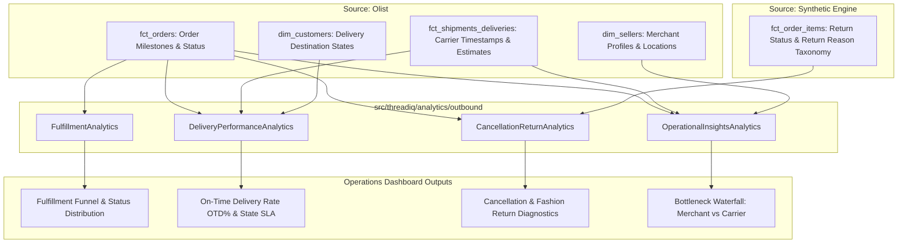

# Outbound Supply Chain & Logistics Analytics Specification

## 1. Executive Summary & Objective

The **Outbound Supply Chain & Logistics Analytics** module of ThreadIQ monitors order fulfillment, carrier delivery SLA compliance, customer cancellations, and product returns across the fashion distribution network.

In digital fashion commerce, post-purchase operations directly influence customer retention and profit margins:
1. Delivery delays erode customer trust and cause order cancellations.
2. High seller dispatch latency consumes logistics buffer time and increases carrier expedite costs.
3. Size and fit mismatch drives elevated apparel return rates, creating costly reverse logistics overhead.
4. Unbalanced fulfillment waterfalls reveal whether fulfillment delays stem from merchant warehouse delays or last-mile carrier transit.

---

## 2. Architecture & Data Lineage

> [!NOTE]
> **Data Provenance Distinction:**
> - Order statuses (`created`, `approved`, `shipped`, `delivered`, `canceled`), seller timestamps, and actual carrier delivery dates are derived directly from the observed Olist logistics dataset (`data_source = 'olist'`).
> - Granular fashion return reasons (`SIZE_FIT`, `STYLE_NOT_AS_PICTURED`, `QUALITY_FABRIC`, `LOGISTICS_DELAY`) are generated via the synthetic returns generator (`source_type = 'synthetic'`) to enrich observed transactional records with industry-standard fashion return taxonomy.

---

## 3. Order Fulfillment Lifecycle Analytics

### 3.1 Fulfillment Funnel Milestones
Every customer transaction progresses through defined operational states:
1. **Orders Placed**: Initial checkout completed and recorded in system.
2. **Orders Approved**: Payment cleared and authorization verified.
3. **Orders Dispatched**: Merchant packed and transferred package to the logistics carrier (`carrier_pickup_timestamp`).
4. **Orders Delivered**: Final physical package delivery verified at consumer doorstep (`actual_delivery_timestamp`).
5. **Orders Canceled**: Pre-fulfillment cancellation or in-transit abort.

### 3.2 Status Distribution
Tracks proportional status distribution across the total order population:
$$\text{Status Share } \% = \frac{\text{Orders in Status } k}{\text{Total Placed Orders}} \times 100$$
Monitors the relative proportion of orders in `delivered`, `shipped`, `canceled`, and `processing`.

---

## 4. Delivery SLA and Carrier Performance

### 4.1 On-Time Delivery (OTD%) and SLA Metrics
- **On-Time Delivery Rate ($OTD\%$)**:
  $$OTD\% = \frac{\text{Delivered Shipments where } t_{\text{actual\_delivery}} \le t_{\text{estimated\_delivery}}}{\text{Total Delivered Shipments}} \times 100$$
- **Late Delivery Rate ($LDR\%$)**:
  $$LDR\% = 100\% - OTD\% = \frac{\text{Delivered Shipments where } t_{\text{actual\_delivery}} > t_{\text{estimated\_delivery}}}{\text{Total Delivered Shipments}} \times 100$$
- **Average Delivery Time ($\bar{T}_{\text{delivery}}$)**:
  Mean elapsed duration from purchase confirmation to customer doorstep:
  $$\bar{T}_{\text{delivery}} = \frac{1}{N_{\text{del}}} \sum_{i=1}^{N_{\text{del}}} \left( t_{\text{actual\_delivery}, i} - t_{\text{purchase}, i} \right) \quad \text{[in calendar days]}$$

### 4.2 Regional Logistics Performance
Aggregates delivery performance across destination states (`customer_state`):
- Delivery volume by state.
- Mean transit days per geographic region.
- Regional $OTD\%$ compliance (identifies regional carrier deficits).

---

## 5. Cancellation and Return Diagnostics

### 5.1 Cancellation & Return Rates
- **Order Cancellation Rate ($OCR$)**:
  $$OCR = \frac{\text{Orders with Status } = \text{'canceled'}}{\text{Total Placed Orders}} \times 100$$
- **Item Return Rate ($IRR$)**:
  $$IRR = \frac{\text{Returned Order Items}}{\text{Total Shipped Order Items}} \times 100$$

### 5.2 Fashion Return Reason Taxonomy
Fashion merchandise exhibits unique return drivers that do not occur in commodity e-commerce. The system classifies return incidents into four primary categories:
1. **`SIZE_FIT`**: Garment does not fit (sizing variance, cut, silhouette).
2. **`STYLE_NOT_AS_PICTURED`**: Color, texture, or appearance deviates from studio photography.
3. **`QUALITY_FABRIC`**: Material defects, stitching flaws, fabric weight disappointment.
4. **`LOGISTICS_DELAY`**: Item arrived past event/need date; buyer refused package.

The analytics engine measures both count frequency and financial return exposure:
$$\text{Refund Value Exposure}_k = \sum_{i \in \text{Returns}_k} \text{item\_price}_i$$

### 5.3 Category Return Patterns
Sub-category level return rates (e.g., Activewear, Footwear, Dresses) highlight categories suffering from disproportionate fit issues or inconsistent brand sizing.

---

## 6. Operational Bottleneck & Waterfall Analysis

### 6.1 Fulfillment Waterfall Deconstruction
To isolate whether delivery delays originate inside merchant warehouses or during carrier transit, total cycle time is split into two disjoint stages:

1. **Stage 1: Merchant Fulfillment (Order-to-Dispatch)**:
   $$\Delta t_{\text{dispatch}} = t_{\text{carrier\_pickup}} - t_{\text{order\_approval}} \quad \text{[hours]}$$
2. **Stage 2: Carrier Transit (Dispatch-to-Delivery)**:
   $$\Delta t_{\text{transit}} = t_{\text{actual\_delivery}} - t_{\text{carrier\_pickup}} \quad \text{[hours]}$$

Total fulfillment duration:
$$\Delta t_{\text{total}} = \Delta t_{\text{dispatch}} + \Delta t_{\text{transit}}$$

Stage share calculation:
$$\text{Stage Share } \% = \frac{\Delta t_{\text{stage}}}{\Delta t_{\text{total}}} \times 100$$

The engine algorithmically designates the **Primary Operational Bottleneck**:
$$\text{Primary Bottleneck} = \begin{cases} 
\text{"Last-Mile / Transit (Carrier)"} & \text{if } \Delta t_{\text{transit}} \ge \Delta t_{\text{dispatch}} \\
\text{"Warehouse / Fulfillment (Seller)"} & \text{if } \Delta t_{\text{dispatch}} > \Delta t_{\text{transit}}
\end{cases}$$

### 6.2 Merchant Dispatch SLA Compliance
Audits individual merchant fulfillment speed against an operational threshold (e.g., 48 hours):
- **Slow Dispatch Rate ($SDR_s$)**: Percentage of seller $s$'s orders exceeding 48 hours before carrier handover.
- Identifies lagging sellers that require operational intervention or automated de-prioritization in storefront search algorithms.

---

## 7. Python Implementation Reference

All outbound supply chain metrics are implemented in `src/threadiq/analytics/outbound/`:
- `FulfillmentAnalytics`: [src/threadiq/analytics/outbound/fulfillment.py](file:///c:/Users/Prince/Desktop/threadiq/src/threadiq/analytics/outbound/fulfillment.py)
- `DeliveryPerformanceAnalytics`: [src/threadiq/analytics/outbound/delivery_performance.py](file:///c:/Users/Prince/Desktop/threadiq/src/threadiq/analytics/outbound/delivery_performance.py)
- `CancellationReturnAnalytics`: [src/threadiq/analytics/outbound/cancellations_returns.py](file:///c:/Users/Prince/Desktop/threadiq/src/threadiq/analytics/outbound/cancellations_returns.py)
- `OperationalInsightsAnalytics`: [src/threadiq/analytics/outbound/operational_insights.py](file:///c:/Users/Prince/Desktop/threadiq/src/threadiq/analytics/outbound/operational_insights.py)

Tested and verified under `tests/test_analytics.py`.
