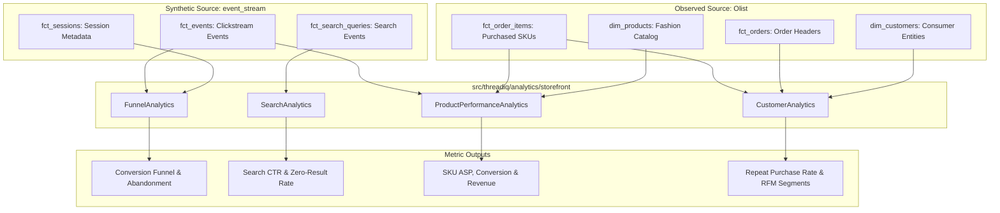

# Storefront Product Analytics Specification

## 1. Executive Summary & Objective

The **Storefront Product Analytics** module within ThreadIQ transforms granular digital customer engagement data and e-commerce transactions into actionable merchandising, conversion rate optimization (CRO), and customer lifecycle intelligence. 

The primary goals of this pillar are:
1. Deconstruct the customer journey from arrival to checkout completion to eliminate shopping friction.
2. Measure search engine effectiveness, query intent fulfillment, and discoverability bottlenecks.
3. Quantify individual SKU and category revenue generation, customer demand elasticity, and conversion velocity.
4. Profile customer lifetime value, repeat ordering dynamics, cohort retention decay, and RFM-based behavioral segmentation.

---

## 2. Architecture & Data Lineage

The storefront analytics module consumes both observed transactional history and synthetic behavioral event stream data, maintaining explicit provenance labels across all aggregations:

> [!NOTE]
> **Data Provenance Distinction:**
> - Clickstream events (`homepage_impression`, `search`, `product_detail_view`, `add_to_cart`, `checkout_started`) originate from the synthetic behavioral simulation engine (`source_type = 'synthetic'`).
> - Customer purchasing events, historical orders, revenues, and repeat customer cohorts originate from the observed Olist e-commerce dataset (`data_source = 'olist'`).
> - Reconciled metrics combining views and purchases join the behavioral sessions to the verified order records.

---

## 3. Customer Conversion Funnel Analysis

### 3.1 Funnel Progression Stages
The storefront customer journey is modeled across six sequential milestones:
1. **Homepage Impression (`homepage_impression`)**: Initial landing on digital storefront.
2. **Product Detail View (`product_detail_view`)**: Consumer navigates to an individual fashion item display page.
3. **Add to Cart (`add_to_cart`)**: Intent to purchase signaled by adding a SKU to the shopping cart.
4. **Checkout Started (`checkout_started`)**: Consumer proceeds to shipping/payment address forms.
5. **Payment Attempted (`payment_attempted`)**: Gateway submission trigger.
6. **Purchase Completed (`purchase_completed`)**: Successful transaction settlement and order creation.

### 3.2 Key Formulas & Mathematical Definitions

1. **Stage Conversion Rate ($CR_{i}$)**:
   $$\text{Stage Conversion Rate}_i = \frac{\text{Unique Sessions reaching Stage } i}{\text{Unique Sessions reaching Stage } i - 1} \times 100$$
2. **Cumulative Funnel Conversion Rate ($CR_{\text{cum}, i}$)**:
   $$\text{Cumulative Conversion Rate}_i = \frac{\text{Unique Sessions reaching Stage } i}{\text{Unique Sessions at Stage 1 (Homepage)}} \times 100$$
3. **Stage Drop-Off Rate ($DO_{i}$)**:
   $$\text{Drop-Off Rate}_i = 100\% - CR_i = \left( 1 - \frac{\text{Sessions}_i}{\text{Sessions}_{i-1}} \right) \times 100$$
4. **Cart Abandonment Rate ($CAR$)**:
   $$\text{Cart Abandonment Rate} = \frac{\text{Sessions with Add to Cart} - \text{Sessions with Purchase}}{\text{Sessions with Add to Cart}} \times 100$$
5. **Checkout Abandonment Rate ($COAR$)**:
   $$\text{Checkout Abandonment Rate} = \frac{\text{Sessions with Checkout Started} - \text{Sessions with Purchase}}{\text{Sessions with Checkout Started}} \times 100$$

### 3.3 Funnel Dimension Slicing
Funnel metrics can be segmented dynamically by:
- **Device Type**: `mobile`, `desktop`, `tablet`. Mobile users exhibit higher cart abandonment due to form friction.
- **Traffic Source**: `organic_search`, `paid_social`, `direct`, `email`. Paid social drives high top-of-funnel discovery but lower checkout completion.

---

## 4. Search and Discovery Analytics

### 4.1 Core Discovery Metrics
- **Popular Queries Table**: Ranked listing of submitted search terms, query frequency, resulting product clicks, and conversion events.
- **Search Click-Through Rate ($CTR_{\text{search}}$)**:
  $$CTR_{\text{search}} = \frac{\text{Searches resulting in a Product Click}}{\text{Total Search Queries Submitted}} \times 100$$
- **Search-to-Purchase Conversion Rate**:
  $$CR_{\text{search}\to\text{purchase}} = \frac{\text{Search Sessions Resulting in Purchase}}{\text{Total Search Sessions}} \times 100$$
- **Zero-Result Search Rate ($ZRSR$)**:
  $$ZRSR = \frac{\text{Search Queries returning 0 Catalog Results}}{\text{Total Search Queries Submitted}} \times 100$$
- **High-Impression, Low-Engagement SKUs**: Products with catalog impressions $> \text{threshold}$ but click-through rates $< 2\%$, indicating poor imagery, uncompetitive pricing, or misleading titles.

---

## 5. Product Performance Analytics

### 5.1 SKU-Level Metrics Table
For every fashion SKU, the analytics engine aggregates commercial velocity:
- **Catalog Views**: Total `product_detail_view` events for the item.
- **Add-to-Cart Count**: Total times added to cart.
- **Units Sold**: Total gross item quantity purchased.
- **Gross Revenue**: Sum of item sale prices ($\sum \text{price}$).
- **Average Selling Price (ASP)**:
  $$\text{ASP} = \frac{\text{Gross Revenue}}{\text{Units Sold}}$$
- **Add-to-Cart Rate ($ATC_{\text{rate}}$)**:
  $$ATC_{\text{rate}} = \frac{\text{Sessions with Add to Cart for SKU}}{\text{Sessions with Product Detail View for SKU}} \times 100$$
- **Product Purchase Conversion Rate ($CR_{\text{product}}$)**:
  $$CR_{\text{product}} = \frac{\text{Unique Sessions Purchasing SKU}}{\text{Unique Sessions Viewing SKU}} \times 100$$

### 5.2 Category Commercial Performance
Rollup by `master_category` and `sub_category`:
- Total units sold, gross category turnover, average transaction value.
- Cross-category conversion benchmarks (e.g., Activewear vs. Footwear).

---

## 6. Customer Analytics & Retention

### 6.1 Repeat Purchase & Lifetime Metrics
- **Total Unique Customers ($N_{\text{cust}}$)**: Distinct buyers identified via verified `customer_unique_id`.
- **Repeat Purchase Rate ($RPR$)**:
  $$RPR = \frac{\text{Unique Customers with } \ge 2 \text{ Completed Orders}}{\text{Total Unique Customers}} \times 100$$
- **Average Order Value (AOV)**:
  $$\text{AOV} = \frac{\text{Total Net Order Revenue}}{\text{Total Completed Orders}}$$

### 6.2 Monthly Cohort Retention Matrix
Customers are grouped into monthly cohorts based on their initial transaction timestamp ($Y_0$). For each subsequent month index ($M_0, M_1, M_2, \dots$), the matrix computes active customer count and retention percentage:
$$\text{Retention Rate}(t) = \frac{\text{Active Customers in Month } t}{\text{Cohort Initial Size at Month } 0} \times 100$$

### 6.3 RFM Behavioral Customer Segmentation
Customers are scored across three dimensions (scale 1 to 5 based on quintiles):
- **Recency ($R$)**: Days since last confirmed purchase.
- **Frequency ($F$)**: Total lifetime order count.
- **Monetary ($M$)**: Total lifetime gross spend.

Composite scoring assigns customers into strategic behavioral segments:
1. **Champions (Loyal High Value)**: High $F$, High $M$, Low $R$ (recent buyers).
2. **Potential Loyalists**: Recent buyers with moderate spend and frequency.
3. **New Recent Customers**: First purchase completed within last 30 days.
4. **At Risk (Past Repeaters)**: Historically high $F$ and $M$ who have not purchased in $> 90$ days.
5. **Dormant One-Time Buyers**: Low $F=1$, long recency ($R > 180$ days).

---

## 7. Python Implementation Reference

All metrics are implemented in the `src/threadiq/analytics/storefront/` package:
- `FunnelAnalytics`: [src/threadiq/analytics/storefront/funnel.py](file:///c:/Users/Prince/Desktop/threadiq/src/threadiq/analytics/storefront/funnel.py)
- `SearchAnalytics`: [src/threadiq/analytics/storefront/search.py](file:///c:/Users/Prince/Desktop/threadiq/src/threadiq/analytics/storefront/search.py)
- `ProductPerformanceAnalytics`: [src/threadiq/analytics/storefront/product_performance.py](file:///c:/Users/Prince/Desktop/threadiq/src/threadiq/analytics/storefront/product_performance.py)
- `CustomerAnalytics`: [src/threadiq/analytics/storefront/customer_analytics.py](file:///c:/Users/Prince/Desktop/threadiq/src/threadiq/analytics/storefront/customer_analytics.py)

Tested and verified under `tests/test_analytics.py`.
