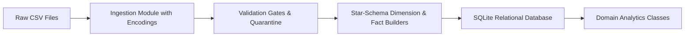

# ThreadIQ — Data Pipeline Specification

## 1. Overview
The ThreadIQ data pipeline transforms raw, heterogeneous e-commerce datasets and stochastic synthetic streams into a unified, star-schema relational model optimized for dimensional querying.



---

## 2. Ingestion & Quality Gates

### Multi-Encoding Ingestion (`src/threadiq/data/ingestion.py`)
- Automatically falls back across UTF-8, Latin-1, and CP1252 to handle international characters in apparel descriptions.
- Validates expected schema and column presence before passing records downstream.

### 7-Point Quality Gates (`src/threadiq/data/cleaning.py`, `validation.py`)
1. **Schema Integrity**: Verifies mandatory primary keys and required attribute presence.
2. **Missing-Value Quarantine**: Records missing critical foreign keys are redirected to quarantine logs rather than silently dropped.
3. **Timestamp Monotonicity**: Verifies that order lifecycle events occur in chronological order:
   $$t_{\text{purchase}} \le t_{\text{approved}} \le t_{\text{carrier\_pickup}} \le t_{\text{delivered}}$$
4. **Non-Negative Constraints**: Validates that prices, freight fees, available inventory, and order quantities are strictly non-negative ($\ge 0$).
5. **Foreign Key Integrity**: Enforces referential integrity across dimensional entities (`dim_customers`, `dim_products`, `dim_sellers`).
6. **Deduplication**: Reconciles duplicate transaction IDs using timestamp-ordered latest-state semantics.
7. **Sequence Validation**: Validates that clickstream events observe pre-requisite steps (e.g. `add_to_cart` requires a preceding session view).

---

## 3. Execution & Reproducibility

The data pipeline can be executed reproducibly via the CLI runner:

```bash
# Full pipeline rebuild with synthetic generation
python scripts/run_pipeline.py --mock-if-missing --recreate-db
```
