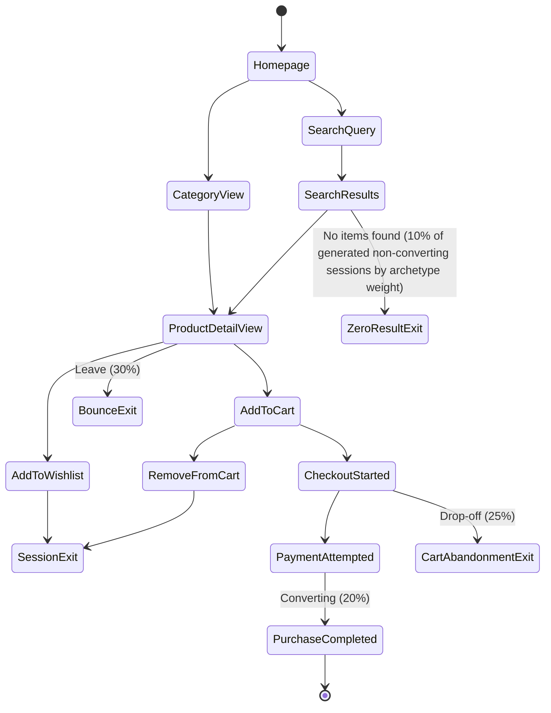

# ThreadIQ — Synthetic Data Methodology

## 1. Executive Summary & Purpose

The ThreadIQ platform integrates real-world public e-commerce order and catalog datasets. However, real transactional datasets inherently lack:
1. **Top-of-funnel customer browsing telemetries:** Sessions, impressions, product detail views, add-to-wishlists, cart additions, and cart removals.
2. **Search discovery logs:** User queries, query results, and zero-result search events.
3. **Daily warehouse inventory time-series:** Daily available vs. reserved stock levels, safety stock thresholds, and stockout events.
4. **Active marketing promotions:** Promotional campaigns, markdown depths, and start/end schedules.

To empower Product Managers to analyze customer funnels, diagnose operational bottlenecks, and evaluate merchandising opportunities without fabricating unverified claims, ThreadIQ generates **strictly labelled, reproducible synthetic datasets**.

Every simulated record carries:
- `source_type = 'synthetic'`
- `data_source = 'synthetic'`

---

## 2. Customer Clickstream Generation Methodology

Synthetic clickstream journeys are generated deterministically by `SyntheticDataGenerator` in `src/threadiq/data/synthetic.py` using pseudo-random number generator seeds (`seed = 42`).

### A. Journey Archetypes & State Transition Modeling

Rather than generating disconnected random events, sessions follow realistic e-commerce behavioural state transitions:



### B. Segment Behavioral Distribution
1. **Converting Direct Shopper (20%):** Navigates from homepage or targeted search $\rightarrow$ PDP $\rightarrow$ Add to Cart $\rightarrow$ Checkout $\rightarrow$ Payment $\rightarrow$ Purchase. When order history exists, this sequence back-propagates from the real `fct_orders.purchase_timestamp` and references the purchased product.
2. **Comparison / Wishlist Shopper (20%):** Views multiple products, saves to wishlist, but exits before checkout.
3. **Window Shopper / Bounce (30%):** Views 1 or 2 PDPs from homepage/category and leaves without cart addition.
4. **Cart Abandoner (20%):** Adds items to cart, initiates checkout, but abandons due to friction (e.g. shipping fee, unexpected costs).
5. **Zero-Result Search Bouncer (10%):** Enters out-of-catalog or typo queries (e.g., "vintage velvet kimono"), receives 0 results, and exits.

### C. Temporal Monotonicity & Micro-timestamps
- Timestamps within a session strictly increase:
  - Homepage $\rightarrow$ Category/Search: 10–30 seconds
  - Category $\rightarrow$ Product View: 20–60 seconds
  - Product View $\rightarrow$ Add to Cart: 30–90 seconds
  - Cart $\rightarrow$ Checkout Started: 30–80 seconds
  - Checkout $\rightarrow$ Payment Attempt: 30–90 seconds
- Event IDs follow the unique format: `ev_{session_id}_{step_idx:02d}`.

---

## 3. Daily Inventory Snapshot Methodology

Inventory snapshots simulate warehouse stock dynamics across 60 rolling days for every active SKU.

### A. Product Demand Archetypes
1. **FAST_MOVER (15% of SKUs):** High daily sales velocity ($\sim 6$–$14$ units/day). Rapidly depletes stock and triggers critical replenishment flags when lead times lag.
2. **STEADY_STAPLE (50% of SKUs):** Moderate, predictable sales velocity ($\sim 1.5$–$4.0$ units/day) with regular replenishment cycles.
3. **SLOW_MOVER (25% of SKUs):** Low sales velocity ($\sim 0.1$–$0.8$ units/day) maintaining high Days of Cover ($\text{DoC} > 50$).
4. **SEASONAL_SURGE (10% of SKUs):** High sales surge (up to $2.5\times$ baseline) concentrated during specific campaign windows.

### B. Warehouse & Metric Modeling
- **Simulated Warehouses:** `WH_NORTH_01`, `WH_SOUTH_02`, `WH_CENTRAL_01` (explicitly identified as simulated IDs).
- **Stock Depletion & Reservation:**
  $$\text{available\_quantity} = \max(0, \text{stock\_on\_hand} - \text{reserved\_quantity})$$
- **Days of Cover (DoC):**
  $$\text{Days of Cover} = \frac{\text{available\_quantity}}{\max(\text{historical\_daily\_velocity}, 0.1)}$$
- **Stockout Flag:**
  $$\text{stockout\_flag} = 1 \iff \text{available\_quantity} = 0$$

---

## 4. Promotion Dataset Methodology

Generates structured promotional campaigns:
- **Discounts:** Standardised fashion markdown tiers: 10%, 15%, 20%, 25%, 30%, 40%, 50%.
- **Campaign Durations:** 5 to 21 days with strictly verified `end_date >= start_date`.
- **Campaign Types:** `SEASONAL_CLEARANCE`, `FLASH_SALE`, `CATEGORY_DISCOUNT`, `NEW_CUSTOMER_VOUCHER`.

---

## 5. How to Regenerate Datasets

To regenerate all synthetic datasets with custom seed or scale:

```powershell
# Default regeneration (Seed 42)
python scripts/run_pipeline.py --mock-if-missing --recreate-db

# Custom database path or raw inputs
python scripts/run_pipeline.py --recreate-db --db-url sqlite:///data/threadiq.db
```

Programmatic generation via Python:
```python
from src.threadiq.data.synthetic import SyntheticConfig, SyntheticDataGenerator

cfg = SyntheticConfig(seed=42, n_dropoff_sessions=2000, inventory_days=90)
generator = SyntheticDataGenerator(cfg)
df_sess, df_events, df_searches = generator.generate_clickstream_dataset(customers_df, products_df, orders_df, items_df)
df_inv = generator.generate_inventory_dataset(products_df)
df_promos = generator.generate_promotions_dataset(products_df)
```

---

## 6. Limitations of Simulated Behavior

1. **Synthetic Clickstream:** Represents simulated behavior based on standard industry drop-off distributions; it does not reflect actual historical clickstream telemetry from any real fashion brand.
2. **Correlation vs. Causation:** Patterns in synthetic funnels are designed to demonstrate diagnostic tools (e.g. drop-off segmentation), not to infer real consumer psychology.
3. **Warehouse Identifiers:** Warehouse IDs (`WH_NORTH_01`, etc.) are synthetic operational constructs for logistics modeling.
