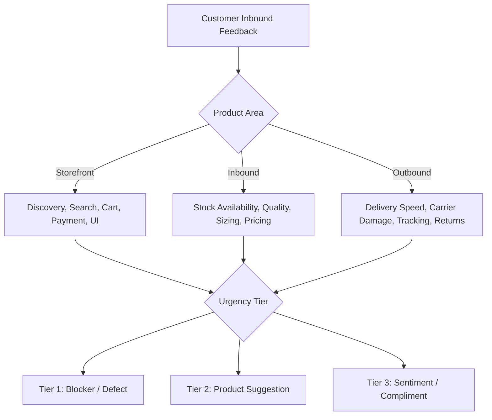

# Customer Feedback Classification Framework

## 1. Purpose & Intake Channels
The **Customer Feedback Classification Framework** structures qualitative customer sentiment, support inquiries, and post-purchase surveys into quantitative product inputs for ThreadIQ's backlog.

### Primary Feedback Channels:
1. **Post-Purchase NPS / CSAT Surveys**: Delivered 3 days post-delivery.
2. **Customer Support Tickets (Zendesk / Intercom)**: Pre-purchase and post-purchase tickets.
3. **Return Reason Submissions**: Mandatory customer tags submitted during reverse logistics requests.
4. **On-Site Session Exit Feedback**: Micro-surveys on abandoned carts and search zero-result screens.

---

## 2. Taxonomy & Categorization Scheme

All incoming feedback is tagged across three structured dimensions:
`[Product Area] : [Sub-Category] : [Sentiment / Urgency]`

### Structured Feedback Tags

| Tag Code | Product Area | Classification Name | Typical Verbatim Quotes | Routed Backlog Initiative |
| :--- | :--- | :--- | :--- | :--- |
| `SF-SRC-01` | Storefront | Search Zero Result / Ineffective | *"I searched for sneakers and nothing showed up!"* | `OPT-03`: Semantic Search Expansion |
| `SF-CHK-01` | Storefront | Payment / Checkout Friction | *"Apple Pay button disappeared on my phone."* | `OPT-02`: Express Checkout & Wallets |
| `IN-STK-01` | Inbound | Out of Stock / Unfulfilled Demand | *"My size is always sold out in black leggings."* | `OPT-04`: Dynamic DoC Replenishment |
| `IN-CAT-01` | Inbound | Inaccurate Imagery or Description | *"The blue shirt looks navy in the photos but arrived baby blue."* | `OPT-06`: Catalog Completeness & Quality |
| `OB-DEL-01` | Outbound | Delayed Logistics Delivery | *"My package arrived 5 days late, past my event."* | `OPT-05`: Dynamic Multi-Carrier Routing |
| `OB-RET-01` | Outbound | Sizing & Fit Mismatch | *"Ordered a Medium according to size chart, but it was way too tight."* | `OPT-01`: Fit & Sizing Intelligence Engine |

---

## 3. Feedback Synthesis & Backlog Integration
1. **Weekly Feedback Triage**: Product Managers review automated weekly sentiment clusters.
2. **Frequency & Volume Weighting**: Issues with $\ge 15$ weekly tags automatically trigger a technical investigation.
3. **RICE Feedback Multiplier**: High customer support volume boosts the Confidence ($C$) parameter in RICE scoring from $0.8$ to $1.0$.
