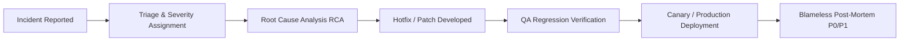

# Standard Operating Procedure (SOP): Product Defect & Issue Tracking

## 1. Objective & Scope
This Standard Operating Procedure defines the lifecycle, severity classification, escalation paths, and resolution SLAs for product defects, anomalies, and data pipeline incidents across ThreadIQ.

---

## 2. Issue Severity Classification Matrix

| Severity Level | Definition | Impact Examples | Response SLA | Target Resolution SLA | Escalation Owner |
| :---: | :--- | :--- | :---: | :---: | :--- |
| **P0 — Critical** | Total platform outage, payment processing down, or major data corruption impacting production commerce. | Checkout completely broken; payment gateway returning 500 errors; inventory table wiped. | **15 minutes** | **< 4 hours** | Head of Engineering, Principal PM |
| **P1 — High** | Core customer flow impaired with no obvious workaround; significant revenue or SLA leakage. | Apple Pay failing on iOS; fit advisor returning incorrect sizes for Activewear; carrier tracking sync failing. | **1 hour** | **< 24 hours** | Lead PM, Engineering Manager |
| **P2 — Medium** | Non-critical functionality degraded; viable workaround exists; reporting or dashboard latency. | Search synonym mapping returning occasional duplicates; Streamlit dashboard filter slow (> 5s); catalog quality alert email delayed. | **4 hours** | **< 3 business days** | Feature PM, Senior Engineer |
| **P3 — Low** | Cosmetic defects, minor UI inconsistencies, typographical errors. | Misaligned button margin on desktop; typo in size chart modal; minor color contrast flaw. | **1 business day** | **Next Sprint Backlog** | Product Designer, QA Engineer |

---

## 3. Incident Lifecycle Workflow

### Detailed Steps:
1. **Reporting**: Ticket filed via Jira / GitHub Issues with mandatory fields:
   - Summary, Affected Module (Storefront, Inbound, Outbound, Data Pipeline, Dashboard).
   - Steps to Reproduce, Expected vs. Actual Behavior, Logs/Screenshots.
   - Severity Proposal, Environment (Prod, Staging).
2. **Triage**: Product Manager and On-Call Lead verify reproducibility and confirm Severity within Response SLA.
3. **Investigation & Hotfix**: Feature branch cut (`fix/issue-id`). Engineering isolates root cause.
4. **QA Verification**: Automated test suite run (`pytest tests/`) + manual regression testing.
5. **Deployment**: Approved patch deployed following standard release gates.
6. **Post-Mortem**: For all P0 and P1 incidents, a blameless post-mortem must be published within 48 hours documenting timeline, root cause, impact, and preventive action items.
