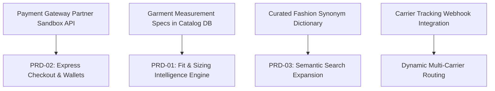

# ThreadIQ — Risk and Dependency Tracker

## 1. Active Risk Log

| Risk ID | Product Area | Risk Description | Severity | Likelihood | Impact Score | Mitigation Strategy | Owner | Status |
| :---: | :---: | :--- | :---: | :---: | :---: | :--- | :---: | :---: |
| `RSK-01` | Outbound | Sizing model recommends inaccurate size due to non-standard supplier cut, causing return spike. | High | Med | **HIGH** | Ingest garment stretch elasticity; incorporate customer return feedback loops to calibrate brand sizing offsets. | Product Lead | **MITIGATING** |
| `RSK-02` | Storefront | Third-party payment gateway downtime or latency on Pix / Apple Pay halts checkout. | Critical | Low | **HIGH** | Implement redundant secondary gateway fallback; cache checkout state locally for 15-minute resumption. | Lead Architect | **MONITORED** |
| `RSK-03` | Storefront | Overly broad synonym expansion returns irrelevant products, diluting customer search trust. | Med | Med | **MED** | Restrict expansion to verified dictionary pairs; rank exact title matches above expanded synonyms. | Search PM | **CONTROLLED** |
| `RSK-04` | Inbound | Supplier batch uploads omit mandatory season/usage fields, causing catalog blind-spots. | Med | High | **MED** | Enforce automated schema validator on batch ingestion; quarantine non-compliant listings. | Inbound PM | **MITIGATED** |
| `RSK-05` | Outbound | 3PL carrier strikes or regional depot bottlenecks cause massive SLA breaches. | High | Low | **HIGH** | Dynamic multi-carrier routing engine dynamically shifts volume away from congested carrier routes. | Logistics Lead | **PLANNED** |

---

## 2. Technical & Cross-Functional Dependency Tracker

| Dependency ID | Dependent Feature | Dependency Description | External / Internal Team | Critical Path? | Target Delivery Date | Status |
| :---: | :--- | :--- | :--- | :---: | :---: | :---: |
| `DEP-01` | `PRD-02: Express Checkout` | Payment processor merchant sandbox credentials & Pix API. | External Gateway Partner | **YES** | 2026-11-20 | **ON TRACK** |
| `DEP-02` | `PRD-01: Fit Advisor` | Verified garment measurement table (chest, waist, inseam). | Inbound Merchandising Team | **YES** | 2026-11-25 | **ON TRACK** |
| `DEP-03` | `PRD-03: Semantic Search` | Validated 500-pair fashion synonym taxonomy dictionary. | Merchandising & Taxonomy Lead | No | 2026-11-18 | **COMPLETED** |
| `DEP-04` | `OPT-05: Carrier Routing` | Carrier API integration for real-time tracking webhooks. | Third-Party 3PL Logistics | No | 2026-12-15 | **SCHEDULED** |
