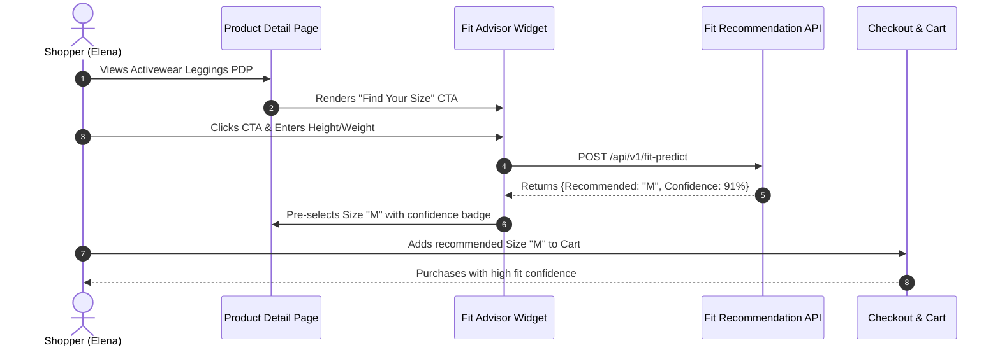

# Product Requirement Document (PRD) 01: Digital Fit & Sizing Intelligence Engine

## 1. Product Overview
The **Digital Fit & Sizing Intelligence Engine** is a machine-learning powered sizing recommendation service embedded on all fashion apparel Product Detail Pages (PDPs). It eliminates sizing guesswork by translating consumer biometric inputs (height, weight, body shape, fit preference) and past brand sizing data into high-confidence size recommendations.

---

## 2. Problem Statement
Production analytics in ThreadIQ reveal that **23.21% of ordered apparel items are returned**, representing $938.99 in refund exposure across sampled orders. Diagnostic analysis demonstrates that **Size & Fit is the single dominant return reason at 38.46%** ($349.39 refund value). Specific categories suffer acute vulnerability: **Activewear exhibits a 60.00% return rate**. Reverse logistics costs, restocking depreciation, and customer dissatisfaction severely erode net merchandise margin.

---

## 3. User Personas
- **Primary Persona**: *Elena, 29, Urban Professional & Activewear Shopper*. Buys leggings and tops online. Frustrated by inconsistent sizing between brands (e.g. Medium in one brand fits like Small in another). Often orders two sizes (bracketing) or abandons purchase due to fit uncertainty.
- **Secondary Persona**: *Marcus, 34, Occasional Fashion Buyer*. Wants rapid sizing guidance without measuring himself with a tape measure.

---

## 4. User Pain Points
1. Static size charts in image format are difficult to read on mobile devices.
2. Inconsistent cut and sizing across garment manufacturers.
3. Lack of clarity on fabric elasticity, compression level, or garment silhouette (e.g. "oversized" vs "slim").
4. Burden of managing physical returns, drop-offs, and refund delays.

---

## 5. Goals and Non-Goals
### Goals
- Reduce the overall apparel item return rate from $23.2\%$ to $\le 15.0\%$.
- Reduce the share of returns caused by `SIZE_FIT` from $38.5\%$ to $< 20.0\%$.
- Provide personalized size recommendations to $\ge 45\%$ of active apparel PDP visitors.
- Maintain PDP page load latency within $\le 120\text{ms}$ overhead.

### Non-Goals
- Developing physical 3D body-scanning hardware.
- Custom tailoring or made-to-measure garment manufacturing.
- Immediate coverage of non-sized accessory categories (e.g. Bags, Eyewear).

---

## 6. Proposed Solution
An interactive **"Find My Fit"** modal widget on apparel PDPs:
1. Prompts for height (cm/ft), weight (kg/lbs), age, and preferred fit style (Fitted, Regular, Relaxed).
2. Cross-references garment measurement specifications (`article_type`, `sub_category`, stretch elasticity) from `dim_products`.
3. Displays a persistent personalized badge: *"Your recommended size is L (88% confidence)"*.
4. Automatically pre-selects the recommended size tile on the PDP.

---

## 7. User Stories
- **US-101**: *As a shopper*, I want to enter my height and weight so that I receive an immediate size recommendation without needing a measuring tape.
- **US-102**: *As an activewear buyer*, I want to know if a pair of leggings runs tight or true to size so that I do not order the wrong compression fit.
- **US-103**: *As a returning customer*, I want the system to remember my fit profile across sessions so that I do not have to re-enter my measurements.

---

## 8. Functional Requirements
1. **Biometric Input Modal**: Support metric and imperial units with slider/input controls.
2. **Algorithmic Fit Scoring**: Calculate match score across catalog sizes (XS to XXL).
3. **Fit Preference Adjustment**: Allow toggle between "Tight / Athletic", "Standard / Regular", and "Loose / Relaxed".
4. **PDP UI Integration**: Position widget immediately adjacent to the size selector tiles.
5. **Session Persistence**: Store user fit profile in encrypted local storage and user profile table.
6. **Garment Attribute Ingestion**: Ingest fabric stretch classification from inbound catalog metadata.

---

## 9. Non-Functional Requirements
- **Performance**: Recommendation API endpoint must respond in $< 80\text{ms}$ at p95.
- **Scalability**: Capable of serving 5,000 concurrent sizing queries during promotional spikes.
- **Privacy & Security**: Zero persistent storage of biometric data without explicit user consent; fully GDPR and LGPD compliant.
- **Accessibility**: WCAG 2.1 AA compliant; full keyboard accessibility and screen-reader support.

---

## 10. User Journey

---

## 11. Acceptance Criteria
1. Given a user views an apparel PDP, when they click "Find Your Size", a responsive modal opens in $< 100\text{ms}$.
2. Given valid height (165 cm) and weight (60 kg) inputs, when submitted, the system returns a single primary recommended size and confidence percentage within $150\text{ms}$.
3. Given a recommended size, the PDP size tile corresponding to that size is highlighted with an endorsement badge.
4. Given a saved profile, subsequent visits to apparel PDPs auto-display the recommendation without re-prompting.

---

## 12. Success Metrics
- **Primary Metric**: Apparel Item Return Rate (Target: $\le 15.0\%$, from $23.21\%$).
- **Secondary Metric**: `SIZE_FIT` Return Reason Share (Target: $< 20.0\%$, from $38.46\%$).
- **Guardrail Metric**: PDP Add-to-Cart Rate must not decrease (Tolerance: $\ge 0.0\%$ delta).

---

## 13. Dependencies
- Catalog metadata pipeline providing garment fit type and stretch elasticity.
- Historical returns dataset for recommendation model tuning.
- Frontend component library integration with mobile PDP templates.

---

## 14. Risks & Mitigations
- *Risk*: Users distrust algorithmic sizing advice and continue bracketing orders.
  - *Mitigation*: Display social proof (e.g. *"84% of customers with your profile kept Size M"*).
- *Risk*: Inaccurate supplier size charts lead to faulty recommendations.
  - *Mitigation*: Incorporate customer return feedback loops to automatically calibrate brand sizing offsets.

---

## 15. Rollout Plan
1. **Phase 1 (Alpha - 2 Weeks)**: Internal employee testing on 100 apparel SKUs.
2. **Phase 2 (A/B Test - 4 Weeks)**: 50/50 randomized trial on Activewear and Topwear (`EXP-01`).
3. **Phase 3 (General Availability - 2 Weeks)**: 100% rollout across all sized apparel categories upon passing statistical significance and guardrail gates.
