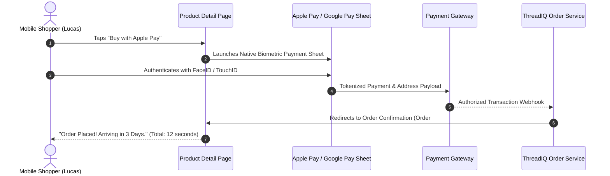

# Product Requirement Document (PRD) 02: 1-Click Express Checkout & Digital Wallets

## 1. Product Overview
The **1-Click Express Checkout & Digital Wallets** initiative overhauls ThreadIQ's transactional checkout funnel by introducing express digital payment integrations (Apple Pay, Google Pay, Pix instant payment) and single-page accordion checkout flows with automated address lookup.

---

## 2. Problem Statement
Conversion funnel telemetry reveals that **89.02% of users who initiate checkout drop off before completing payment**, causing overall session conversion to plunge from $26.54\%$ down to $2.91\%$. Concurrently, **Cart Abandonment Rate stands at 93.25%** (622 abandoned sessions out of 667 cart events). Friction points include tedious multi-step form fields, manual credit card entry on mobile devices, and lack of modern digital wallet methods.

---

## 3. User Personas
- **Primary Persona**: *Lucas, 26, Mobile-First Shopper*. Browses fashion on his smartphone during daily transit. Values speed. Will instantly bounce if forced to type out a 16-digit credit card number or complete extensive billing address forms on a mobile keyboard.
- **Secondary Persona**: *Camila, 31, Desktop Shopper*. Prefers bank transfer or instant QR-code payment (Pix) with clear installment visibility.

---

## 4. User Pain Points
1. Excessively long multi-step checkout requiring 14+ form fields across 3 separate pages.
2. Card authorization failures and cumbersome 3D-Secure redirection on mobile browsers.
3. Lack of upfront shipping cost visibility until the final payment page.
4. Absence of 1-tap mobile payment options (Apple Pay, Google Pay).

---

## 5. Goals and Non-Goals
### Goals
- Increase the Checkout Completion Rate from $10.98\%$ to $\ge 25.0\%$.
- Reduce Cart Abandonment Rate from $93.25\%$ to $\le 75.0\%$.
- Enable sub-30-second checkout for returning users with saved credentials or biometric wallets.
- Zero increase in payment gateway chargeback rates ($< 0.05\%$).

### Non-Goals
- Building an internal banking ledger or proprietary merchant credit card processor.
- Cryptocurrency or buy-now-pay-later (BNPL) integrations in Phase 1.
- In-store point-of-sale (POS) terminal hardware.

---

## 6. Proposed Solution
1. **Single-Page Express Checkout**: Collapse shipping, delivery method, and payment into a unified single-screen responsive accordion.
2. **Top-of-Funnel Express Wallets**: Render Apple Pay and Google Pay buttons directly on the Cart Drawer and PDP for instant purchase.
3. **Pix Instant QR & Copy-Paste**: Integrate real-time dynamic Pix payment with automated status polling.
4. **Postal Code (CEP) Address Auto-Fill**: Automatically populate state, city, and neighborhood upon typing a 5-digit postal code.

---

## 7. User Stories
- **US-201**: *As a mobile user*, I want to tap Apple Pay on the product page so that I can purchase an item instantly using FaceID without typing my shipping address.
- **US-202**: *As a customer paying via Pix*, I want an instant QR code and copy-paste key so that I can complete payment in my banking app with immediate order confirmation.
- **US-203**: *As a shopper*, I want to enter my postal code and have my street and city autofill so that I avoid typing errors on small screens.

---

## 8. Functional Requirements
1. **Express Payment Gateway SDK**: Integrate Stripe / Adyen / EBANX SDK supporting Apple Pay, Google Pay, and Pix.
2. **Dynamic Shipping Calculation**: Update shipping options and totals asynchronously via AJAX when postal code is entered.
3. **1-Click Cart Buy Now CTA**: Render secondary "Express Buy" button on PDP alongside standard "Add to Cart".
4. **Guest Checkout Default**: Allow guest checkout with post-purchase account creation option (single password field).
5. **Real-Time Payment Webhook Handler**: Listen for async Pix payment confirmation and transition order status from `processing` to `approved` within 3 seconds.

---

## 9. Non-Functional Requirements
- **Checkout Latency**: Complete checkout payload processing in $< 500\text{ms}$.
- **Security Compliance**: Level 1 PCI-DSS compliance; zero plain-text card data touching ThreadIQ application servers.
- **Reliability & Uptime**: 99.99% availability during high-traffic promotional flash sales.
- **Browser Compatibility**: Safari iOS (Apple Pay), Chrome Android (Google Pay), Edge, Firefox.

---

## 10. User Journey

---

## 11. Acceptance Criteria
1. Given a user on Safari iOS with Apple Pay configured, when viewing the cart, the Apple Pay button is visible and active.
2. When Apple Pay is authorized, the order is created in `fct_orders` with status `approved` without requiring manual address entry.
3. Given a user selecting Pix, a dynamic QR code and copyable hash key are rendered within $300\text{ms}$, and receipt confirmation updates the UI upon webhook receipt without manual page reload.
4. Address lookup API resolves Brazilian CEP / postal code in $< 150\text{ms}$.

---

## 12. Success Metrics
- **Primary Metric**: Checkout Completion Rate (Target: $\ge 25.0\%$, baseline $10.98\%$).
- **Secondary Metric**: Mobile Cart Abandonment Rate (Target: $\le 75.0\%$, baseline $93.25\%$).
- **Efficiency Metric**: Average Checkout Time (Target: $< 45\text{ seconds}$ on mobile).
- **Guardrail Metric**: Chargeback Rate (Target: $< 0.05\%$).

---

## 13. Dependencies
- Payment gateway partner merchant agreement and sandbox API keys.
- Address lookup postal code database service.
- Order management system support for instant asynchronous webhook settlement.

---

## 14. Risks & Mitigations
- *Risk*: Pix payments abandoned if banking app switch fails.
  - *Mitigation*: Provide 15-minute reservation timer with clear visual countdown and SMS reminder.
- *Risk*: Safari / Chrome browser compatibility fragmentation.
  - *Mitigation*: Graceful fallback to single-page credit card accordion if digital wallet is unavailable.

---

## 15. Rollout Plan
1. **Phase 1 (Sandbox & Security Audit - 2 Weeks)**: PCI-DSS compliance audit and end-to-end tokenization tests.
2. **Phase 2 (A/B Test - 3 Weeks)**: 50/50 randomized trial on mobile checkout traffic (`EXP-02`).
3. **Phase 3 (Full Rollout - 1 Week)**: 100% production rollout across mobile and desktop.
