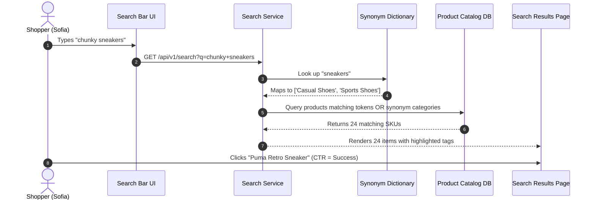

# Product Requirement Document (PRD) 03: Semantic Search & Dynamic Synonym Expansion

## 1. Product Overview
The **Semantic Search & Dynamic Synonym Expansion Engine** modernizes the ThreadIQ storefront product discovery system by replacing brittle keyword matching with natural language query parsing, fashion domain synonym mapping, typo tolerance, and intelligent zero-result fallback recommendations.

---

## 2. Problem Statement
Search analytics reveal an unsustainable **85.96% Zero-Result Search Rate** across customer search logs (147 out of 171 recorded queries yielded 0 results). Customer queries using natural fashion terminology (e.g. *"vintage velvet kimono"*, *"gold sequin sneakers"*, *"titanium trenchcoat"*) fail entirely because the catalog engine searches for exact string substrings against strict product titles. Consequently, **Search Click-Through Rate is suppressed at 14.04%**, and customers bounce from the storefront within seconds.

---

## 3. User Personas
- **Primary Persona**: *Sofia, 24, Trend-Driven Shopper*. Uses descriptive, aesthetic search terms learned on TikTok and Instagram (e.g. "oversized blazer", "chunky sneakers", "athleisure shorts"). Expects Google-like search tolerance and relevant visual results.
- **Secondary Persona**: *Gabriel, 38, Specific Category Shopper*. Searches for functional attributes like "running shoes" or "work trousers" without knowing brand-specific catalog nomenclature.

---

## 4. User Pain Points
1. Typing natural product synonyms (e.g., "sneakers" instead of "Casual Shoes") returns a blank page stating "0 results found".
2. Minor typing mistakes on mobile devices ("shues", "drss") yield complete search failure.
3. Zero-result search pages present a dead end with no helpful alternative suggestions, causing immediate site abandonment.

---

## 5. Goals and Non-Goals
### Goals
- Reduce the Zero-Result Search Rate from $85.96\%$ to $< 15.0\%$.
- Increase Search Click-Through Rate (CTR) from $14.04\%$ to $\ge 35.0\%$.
- Increase Search-to-Purchase Conversion Rate from $14.04\%$ to $\ge 25.0\%$.
- Maintain search response latency $< 100\text{ms}$ at p95.

### Non-Goals
- Multi-modal image-to-image search (e.g. uploading a photo to search) in Phase 1.
- Voice-activated audio search hardware integration.
- Full vector embedding neural search infrastructure (Phase 1 focuses on lexical semantic expansion and synonym dictionaries).

---

## 6. Proposed Solution
1. **Fashion Domain Synonym Dictionary**: Curated bidirectional taxonomy mapping colloquial search terms to canonical catalog categories:
   - "sneakers", "trainers", "kicks" $\to$ `Casual Shoes` / `Sports Shoes`
   - "jacket", "coat", "outerwear" $\to$ `Jackets` / `Sweaters`
   - "jeans", "denim", "pants" $\to$ `Trousers` / `Bottomwear`
2. **Fuzzy Levenshtein Typo Tolerance**: Automatic correction for edit distance $\le 2$ on search terms exceeding 4 characters.
3. **Automated Zero-Result Fallback Merchandising**: When a query produces zero direct matches, render a curated grid: *"We couldn't find exact matches for [Query], but you might love these trending styles in [Nearest Category]"*.
4. **Search Autocomplete & Instant Previews**: Real-time 4-item visual product thumbnail dropdown as the user types $\ge 3$ characters.

---

## 7. User Stories
- **US-301**: *As a shopper*, I want searching for "sneakers" to show all casual and athletic shoes so that I don't need to guess the exact brand title.
- **US-302**: *As a mobile user with typos*, I want searching for "sumer dres" to auto-correct to "summer dress" so that I see relevant apparel immediately.
- **US-303**: *As a shopper searching an out-of-stock trend*, I want to see trending items in that aesthetic rather than a blank error screen.

---

## 8. Functional Requirements
1. **Query Tokenizer & Normalizer**: Strip punctuation, lowercase tokens, and stem grammatical suffixes.
2. **Synonym Expansion Middleware**: Intercept search SQL queries and expand WHERE clauses to include mapped synonyms across `article_type`, `sub_category`, and `master_category`.
3. **Typo Tolerance Gating**: Apply Levenshtein distance matching against the active catalog vocabulary.
4. **Zero-Result Detection & Trigger**: If result count equals 0, query top-selling SKUs in the broadest matched category tag.
5. **Analytics Event Instrumentation**: Log `results_count`, `expanded_synonyms`, `was_fallback_rendered`, and `clicked_product_id` in `fct_search_queries`.

---

## 9. Non-Functional Requirements
- **Query Latency**: Search results must render in $< 100\text{ms}$ (p95).
- **Throughput**: Support 1,000 queries per second without CPU saturation.
- **Maintainability**: Synonym mappings stored in configurable database table (`dim_search_synonyms`) editable via admin portal without code re-deployment.

---

## 10. User Journey

---

## 11. Acceptance Criteria
1. Given a user queries "sneakers", when executed, products categorized under `Casual Shoes` and `Sports Shoes` are returned.
2. Given a user enters a misspelled query with edit distance 1 (e.g. "shurt"), the system auto-corrects to "shirt" and displays a notice: *"Showing results for shirt"*.
3. Given an obscure query that yields zero exact matches, the page displays trending category items rather than an empty page.
4. p95 search API latency remains under $100\text{ms}$.

---

## 12. Success Metrics
- **Primary Metric**: Zero-Result Search Rate (Target: $< 15.0\%$, from $85.96\%$).
- **Secondary Metric**: Search Click-Through Rate (Target: $\ge 35.0\%$, from $14.04\%$).
- **Commercial Metric**: Search-to-Purchase Conversion Rate (Target: $\ge 25.0\%$, from $14.04\%$).
- **Guardrail Metric**: Search Bounce / Exit Rate (Target: reduce by $\ge 30\%$).

---

## 13. Dependencies
- Product catalog text indexing and database full-text search capability.
- Curated fashion taxonomy mappings.
- Storefront search UI components supporting autocomplete dropdowns.

---

## 14. Risks & Mitigations
- *Risk*: Overly broad synonym expansion returns irrelevant products (e.g., "dress" matching "dressing gown").
  - *Mitigation*: Restrict synonym expansion to high-confidence curated synonym pairs; rank exact title matches above expanded synonym matches.
- *Risk*: Query expansion increases database latency.
  - *Mitigation*: Cache expanded queries in Redis / in-memory cache with 1-hour TTL.

---

## 15. Rollout Plan
1. **Phase 1 (Dictionary Verification - 1 Week)**: Audit and validate 500 core fashion synonym mappings against catalog inventory.
2. **Phase 2 (A/B Test - 3 Weeks)**: 50/50 randomized traffic trial (`EXP-03`).
3. **Phase 3 (Full Rollout - 1 Week)**: 100% production release upon passing search CTR and latency criteria.
