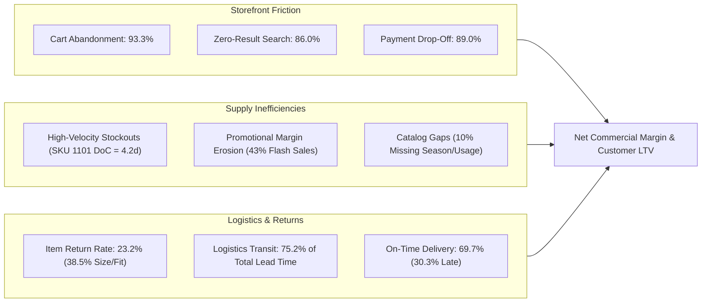
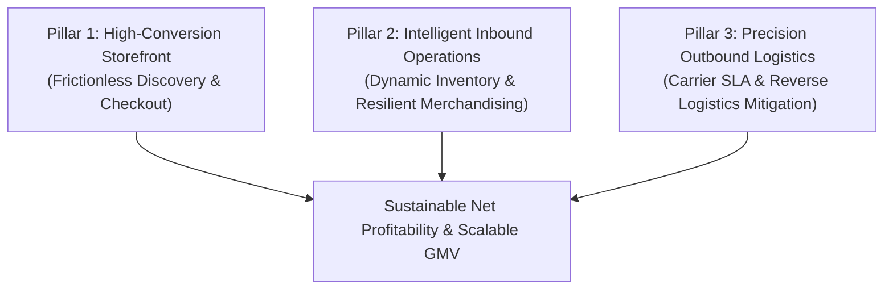

# ThreadIQ — Product Strategy & Decision Intelligence Framework

## 1. Executive Summary & Vision

**ThreadIQ** is an integrated Product Intelligence and Operational Decision Platform designed specifically for fashion e-commerce.

Modern fashion e-commerce operates at the intersection of high digital consumer intent and fragile supply chain logistics. Unlike commodity retail, fashion commerce is constrained by:
- **High Sizing & Aesthetic Friction**: Sizing ambiguity drives elevated return rates (20–30% industry-wide), degrading customer trust and eroding net margin.
- **Short Seasonality & Inventory Perishability**: Fashion SKUs carry short lifecycles; stockouts on high-velocity items cause permanent customer substitution, while slow-moving styles lock up working capital and force margin-diluting clearance markdowns.
- **Last-Mile Asymmetry**: Delivery delays directly amplify order cancellations and return rates, making outbound logistics an essential driver of customer lifetime value (LTV).

### Product Vision
> *"To bridge the gap between digital consumer behavior and physical supply chain execution by providing real-time diagnostic intelligence, algorithmic decision support, and closed-loop experimentation across Storefront, Inbound, and Outbound operations."*

---

## 2. Evidence-Based Problem Diagnosis

The strategic roadmap for ThreadIQ is grounded directly in quantitative findings uncovered during the platform's initial analytics audit:

### 2.1 Storefront Conversion Leakage
- **93.25% Cart Abandonment**: More than 9 out of 10 shopping bags are abandoned prior to purchase completion.
- **85.96% Zero-Result Search Rate**: Catalog search fails to parse natural consumer search queries (e.g., *"vintage velvet kimono"*, *"titanium trenchcoat"*), driving high bounce rates and suppressing organic discovery.
- **89.02% Checkout-to-Payment Drop-Off**: Cumbersome multi-step checkout forms and absence of native express wallets cause high-intent drop-off at the final payment confirmation step.

### 2.2 Inbound Sourcing & Inventory Imbalance
- **Days of Cover (DoC) Divergence**: Top-velocity fashion SKUs operate at critical stockout risk (SKU 1101 with only 4.2 days of cover), while slow-moving styles stagnate above 60+ days of cover.
- **Heavy Discounting Addiction**: 43.3% of promotional campaigns are high-discount Flash Sales averaging 30% markdown depth, compressing gross product margins.
- **Catalog Attribute Incompleteness**: 10% of SKUs lack critical season and usage tags, preventing collection-based merchandising.

### 2.3 Outbound Fulfillment & Reverse Logistics Overhead
- **23.21% Apparel Item Return Rate**: Returns cost $938.99 across sampled transactions, with **Size & Fit accounting for 38.46%** of all returns and **Activewear reaching a 60% return rate**.
- **Logistics Delivery Bottleneck**: Carrier transit consumes **75.15% of total order fulfillment time** (171.2 hours vs. 56.7 hours for merchant dispatch).
- **Sub-Standard Delivery SLA**: Only **69.70% of deliveries arrive on time**, creating customer anxiety and elevating order cancellation rates to **11.11%**.

---

## 3. Strategic Product Pillars

To systematically resolve these challenges, ThreadIQ establishes three core product pillars:

### Pillar 1: High-Conversion Storefront
- **Objective**: Maximize conversion rate (CR) and average order value (AOV) by removing discovery friction and eliminating checkout bottlenecks.
- **Core Initiatives**:
  1. *Semantic Search & Dynamic Synonym Expansion*: Natural language query processing, synonym dictionaries, and intelligent zero-result fallbacks.
  2. *1-Click Express Checkout & Digital Wallets*: Native Pix, Apple Pay, and Google Pay integration with automated address autofill.
  3. *Contextual Cross-Sell Recommendations*: Pairing high-velocity anchors with margin-accretive accessories within matching price brackets.

### Pillar 2: Intelligent Inbound Operations
- **Objective**: Protect gross margin and optimize working capital turnover through predictive replenishment and automated catalog governance.
- **Core Initiatives**:
  1. *Dynamic Days of Cover (DoC) Replenishment Alerts*: Automated vendor purchase orders triggered when DoC approaches lead time buffers.
  2. *Catalog Completeness Enforcement*: Ingestion schema gating rejecting listings with missing season/usage attributes.
  3. *Algorithmic Markdown Optimization*: Automated tiered markdowns (15%/25%/40%) for styles with $DoC > 60$ days to clear slow-moving inventory before terminal obsolescence.

### Pillar 3: Precision Outbound Logistics
- **Objective**: Protect post-purchase customer satisfaction, enforce carrier SLAs, and structurally reduce reverse logistics expenses.
- **Core Initiatives**:
  1. *Digital Fit & Sizing Intelligence Engine*: PDP size recommendation widget leveraging consumer height/weight profiles to eliminate size-mismatch returns.
  2. *Dynamic Multi-Carrier Routing*: Intelligent carrier dispatch allocation matching destination postal codes to the highest on-time probability carrier.
  3. *Proactive Delivery Exception Tracking*: Automated customer delay alerts with preemptive shipping fee credits to mitigate WISMO ("Where Is My Order") support tickets and cancellations.

---

## 4. Product Decision Framework

All product investments in ThreadIQ are governed by a disciplined, quantitative decision framework:

1. **Analytical Evidence Gate**: Every proposed feature must be backed by documented metrics from the ThreadIQ data warehouse.
2. **RICE Prioritization**: All candidate initiatives are scored via RICE (Reach $\times$ Impact $\times$ Confidence / Effort) to determine backlog sequencing (Now, Next, Later).
3. **Rigorous A/B Experimentation**: High-impact customer-facing features must undergo randomized controlled trials with pre-registered primary KPIs, secondary guardrails, and sample size calculations.
4. **Post-Launch Verification**: Operational features must demonstrate sustained lift across trailing 30-day cohorts before complete platform rollouts.
