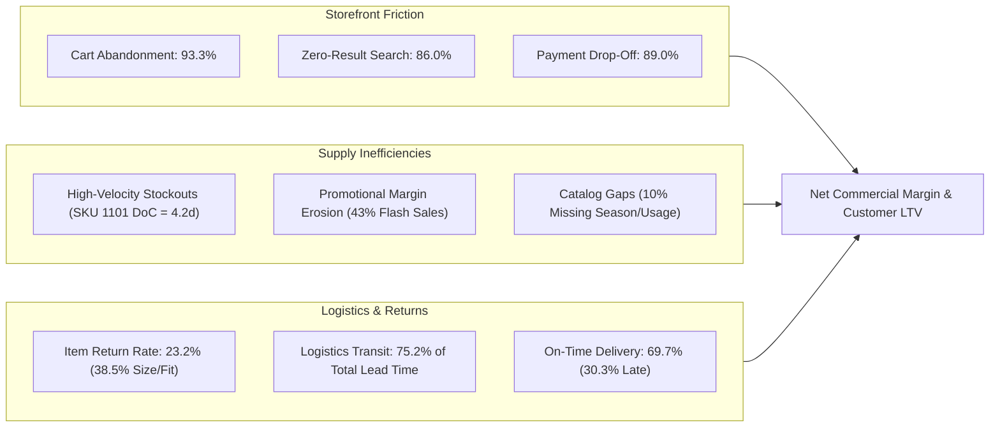
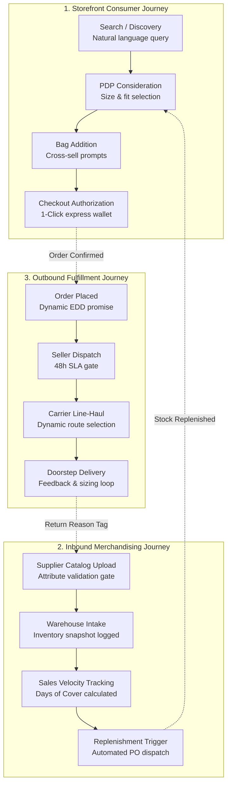

# ThreadIQ — Product Strategy & Decision Intelligence Framework

## 1. Executive Summary & Vision

**ThreadIQ** is an integrated Product Intelligence and Operational Decision Platform designed specifically for fashion e-commerce.

Modern fashion e-commerce operates at the intersection of high digital consumer intent and fragile supply chain logistics. Unlike commodity retail, digital fashion is constrained by:
* **High Sizing & Aesthetic Friction**: Sizing ambiguity drives elevated return rates (20–30% industry-wide), degrading customer trust, increasing reverse logistics costs, and eroding net margin.
* **Short Seasonality & Inventory Perishability**: Fashion SKUs carry compressed lifecycles; stockouts on high-velocity items cause permanent customer substitution, while slow-moving styles lock up working capital and force margin-diluting clearance markdowns.
* **Last-Mile Asymmetry**: Delivery delays directly amplify order cancellations and return rates, making outbound logistics an essential driver of customer lifetime value (LTV) and brand loyalty.

### Product Vision
> *"To bridge the gap between digital consumer behavior and physical supply chain execution by providing real-time diagnostic intelligence, algorithmic decision support, and closed-loop experimentation across Storefront, Inbound, and Outbound operations."*

### Strategic Objectives
1. **Unify Commercial & Logistics Signals**: Break data silos across marketing, merchandising, warehouse inventory, and third-party delivery carriers into a single coherent data model.
2. **Eliminate Customer Friction at Every Touchpoint**: Convert zero-result searches into high-intent views, eliminate checkout abandonment, and eliminate sizing guesswork on product detail pages.
3. **Protect Gross-to-Net Operating Margins**: Curtail unmanaged return rates, minimize safety-stock stockout penalties, and replace blanket discounting with targeted inventory replenishment.

---

## 2. Evidence-Based Problem Diagnosis

The strategic roadmap for ThreadIQ is grounded directly in quantitative findings uncovered during the platform's initial analytics audit:



### 2.1 Storefront Conversion Leakage
* **93.25% Cart Abandonment**: Over 9 out of 10 digital shopping carts are abandoned prior to order placement.
* **85.96% Zero-Result Search Rate**: Catalog search fails to parse natural consumer search queries (e.g., *"vintage velvet kimono"*, *"titanium trenchcoat"*), driving high bounce rates and suppressing organic discovery.
* **89.02% Checkout-to-Payment Drop-Off**: Cumbersome multi-step checkout forms and absence of native express wallets cause high-intent drop-off at the final payment confirmation step.

### 2.2 Inbound Sourcing & Inventory Imbalance
* **Days of Cover (DoC) Divergence**: Top-velocity fashion SKUs operate at critical stockout risk (SKU 1101 with only 4.2 days of cover), while slow-moving styles stagnate above 60+ days of cover.
* **Heavy Discounting Addiction**: 43.3% of promotional campaigns are high-discount Flash Sales averaging 30% markdown depth, compressing gross product margins.
* **Catalog Attribute Incompleteness**: 10% of SKUs lack critical season and usage tags, preventing collection-based merchandising.

### 2.3 Outbound Fulfillment & Reverse Logistics Overhead
* **23.21% Apparel Item Return Rate**: Returns cost $938.99 across sampled transactions, with **Size & Fit accounting for 38.46%** of all returns and **Activewear reaching a 60% return rate**.
* **Logistics Delivery Bottleneck**: Carrier transit consumes **75.15% of total order fulfillment time** (171.2 hours vs. 56.7 hours for merchant dispatch).
* **Sub-Standard Delivery SLA**: Only **69.70% of deliveries arrive on time**, creating customer anxiety and elevating order cancellation rates to **11.11%**.

---

## 3. Target User Personas

ThreadIQ serves four core enterprise and consumer personas across digital commerce and operations:

```
┌────────────────────────────────────────────────────────────────────────┐
│                        CORE USER PERSONAS                              │
├──────────────────┬──────────────────┬─────────────────┬────────────────┤
│ 1. Maya Lin      │ 2. Liam Vance    │ 3. Carlos Ramos │ 4. Sarah Chen  │
│ Consumer Shopper │ Merchandiser     │ Logistics Lead  │ VP E-Commerce  │
│ Mobile-First     │ Inventory Buyer  │ Carrier Ops     │ Business Head  │
└──────────────────┴──────────────────┴─────────────────┴────────────────┘
```

### Persona 1: Maya Lin — Digital Fashion Consumer (End-User)
* **Demographics:** 28 years old, urban professional, mobile-first shopper (82% of visits on iOS/Android).
* **Behaviors:** Browses during evening commute; uses visual search and search bars; checks return policies before buying.
* **Pain Points:** 
  * Gets zero search results when typing descriptive terms (e.g., *"oversized linen blazer"*).
  * Hesitant about sizing across disparate brands, frequently abandoning cart or ordering multiple sizes to try at home (bracketing).
  * Frustrated when promised delivery takes 12+ days or arrives late.
* **Desired Outcome:** Instant search discovery, confident one-click sizing guidance, fast express checkout, and reliable delivery tracking.

### Persona 2: Liam Vance — Senior Fashion Category Merchandiser (Internal User)
* **Role:** Manages Women's Apparel catalog, seasonal buy plans, and inventory replenishment.
* **Behaviors:** Daily review of sales velocity, stock levels, and promotional campaigns.
* **Pain Points:**
  * Discovers high-velocity styles have stocked out days after depletion occurred.
  * Lacks visibility into whether markdowns actually clear slow-moving inventory or merely cannibalize full-price sales.
  * Manually reconciles catalog spreadsheets with missing season/usage attributes.
* **Desired Outcome:** Automated Days-of-Cover alerts, automated reorder PO generation with 30-day safety buffers, and algorithmic markdown guidance.

### Persona 3: Carlos Ramos — Outbound Logistics & Carrier Operations Lead (Internal User)
* **Role:** Oversees 3PL carrier contracts, fulfillment center dispatches, and last-mile SLAs.
* **Behaviors:** Monitors daily dispatch volumes, carrier transit times, and delivery exception queues.
* **Pain Points:**
  * Has no automated way to assign shipments dynamically to the best-performing regional carrier.
  * Inundated with WISMO (*"Where Is My Order?"*) customer support escalations due to transit delays.
  * Absorbs reverse logistics costs without direct feedback loops to garment design or sizing teams.
* **Desired Outcome:** Multi-carrier routing intelligence, automated delivery promise prediction, and reverse logistics root-cause attribution.

### Persona 4: Sarah Chen — VP of E-Commerce & Digital Business (Executive Stakeholder)
* **Role:** Accountable for top-line GMV, contribution margin, customer retention cohorts, and capital efficiency.
* **Behaviors:** Weekly executive reporting, quarterly board reviews, capital allocation across product initiatives.
* **Pain Points:**
  * Sees top-line GMV growth masked by a 23.2% return rate and 93.3% cart abandonment.
  * Lacks a unified executive dashboard connecting digital conversion with physical fulfillment costs.
  * Engineering teams debate roadmap priorities without objective, evidence-based scoring.
* **Desired Outcome:** Unified executive cockpit, disciplined RICE backlog prioritization, and statistically validated A/B experiment readouts.

---

## 4. End-to-End User Journeys across Operational Domains



### 4.1 Storefront Consumer Journey
1. **Search & Discovery:** Shopper enters query $\to$ Semantic engine resolves synonyms and typo variants $\to$ Clean search result grid displayed.
2. **Product Consideration:** Shopper clicks PDP $\to$ Digital Fit Engine evaluates biometric profile $\to$ Recommends size L with 88% confidence $\to$ Sizing tile pre-selected.
3. **Cart & Bag Addition:** Shopper adds item $\to$ Contextual accessories offered without intrusive popups $\to$ Item reserved in warehouse.
4. **Checkout & Purchase:** Shopper opens checkout $\to$ Native digital wallet (Pix / Apple Pay) auto-populates address and payment $\to$ Transaction completed in 1 click.

### 4.2 Inbound Supply Chain Journey
1. **Catalog Ingestion:** Merchant uploads catalog CSV $\to$ Ingestion validator enforces 100% attribute completeness (`season`, `usage`, `color`) $\to$ Gated before storefront indexing.
2. **Inventory Velocity Tracking:** Nightly snapshot computes trailing 30-day unit sales velocity $\to$ Evaluates Days of Cover ($DoC$).
3. **Replenishment PO Generation:** High-velocity SKU reaches $DoC \le 7$ days $\to$ System generates automated reorder recommendation targeting 30-day buffer $\to$ Vendor receives purchase order.
4. **Clearance Liquidation:** Style exceeds $DoC > 60$ days $\to$ Automated tiered markdown (15% $\to$ 25%) initiated to prevent terminal obsolescence.

### 4.3 Outbound Fulfillment Journey
1. **Order Routing & Promise:** Checkout engine calculates dynamic Estimated Delivery Date (EDD) based on origin seller hub and destination state.
2. **Merchant Dispatch SLA:** Seller receives pick-and-pack alert $\to$ 48-hour dispatch clock initiated $\to$ Carrier scans parcel.
3. **Line-Haul & Last-Mile Transit:** Parcel routed through primary regional carrier $\to$ Telemetry tracks transit days against regional SLA.
4. **Post-Delivery Feedback Loop:** Customer confirms receipt $\to$ If returned, structured taxonomy records reason (`SIZE_FIT`, `QUALITY`, `STYLE`) $\to$ Fed back into Digital Fit Engine and merchant scorecard.

---

## 5. Goals and Non-Goals

### Product Goals
* **Pillar 1 (Storefront):**
  * Increase overall visitor-to-order conversion rate from $1.82\%$ to $\ge 2.50\%$.
  * Decrease zero-result search rate from $86.0\%$ to $< 15.0\%$.
  * Reduce final checkout-to-payment drop-off from $89.0\%$ to $< 60.0\%$.
* **Pillar 2 (Inbound):**
  * Eliminate stockouts on top 20% velocity fashion SKUs (maintain in-stock rate $\ge 99.0\%$).
  * Achieve $100\%$ catalog attribute completeness across active listings.
  * Reduce working capital locked in stagnant inventory ($DoC > 60$ days) by $40\%$.
* **Pillar 3 (Outbound):**
  * Reduce apparel item return rate from $23.2\%$ to $\le 15.0\%$.
  * Reduce size-related returns from $38.5\%$ to $< 20.0\%$ of total return volume.
  * Improve on-time delivery rate from $69.7\%$ to $\ge 90.0\%$ across all 27 federated states.

### Non-Goals (Explicit Scope Boundaries)
* **Custom Garment Manufacturing:** ThreadIQ is an intelligence and operations software platform; it does not engage in made-to-measure tailoring or manufacturing.
* **Autonomous Carrier Contract Negotiation:** ThreadIQ provides carrier performance scorecards and routing recommendations; it does not autonomously execute commercial carrier contracts.
* **Core ERP / Financial General Ledger Replacement:** ThreadIQ integrates with existing ERPs via data warehouse tables; it does not replace financial accounting systems.
* **Consumer Social Network Features:** ThreadIQ focuses on commercial conversion, inventory health, and logistics execution; social commerce feeds are out of scope.

---

## 6. Strategic Initiatives & Measurable Outcomes

| Horizon | Initiative / Feature | Target Product Area | Primary Metric | Baseline | Target | Strategic Impact |
| :--- | :--- | :--- | :--- | :---: | :---: | :--- |
| **H1 (Now)** | **Digital Fit & Sizing Intelligence Engine** (PRD #1) | Outbound / Storefront | Apparel Item Return Rate | 23.2% | **$\le 15.0\%$** | Protects net margin; directly mitigates #1 customer return driver. |
| **H1 (Now)** | **1-Click Express Checkout & Wallets** (PRD #2) | Storefront | Checkout Completion Rate | 11.0% | **$\ge 25.0\%$** | Unblocks highest-intent funnel stage; direct GMV acceleration. |
| **H1 (Now)** | **Semantic Search & Dynamic Synonym Expansion** (PRD #3) | Storefront | Zero-Result Search Rate | 86.0% | **$< 15.0\%$** | Converts dead-end searches into active product views. |
| **H1 (Now)** | **Dynamic Days of Cover (DoC) Replenishment** | Inbound | High-Velocity In-Stock Rate | 92.5% | **$\ge 99.0\%$** | Prevents revenue loss on top-selling listings. |
| **H2 (Next)** | **Dynamic Multi-Carrier Routing Engine** | Outbound | On-Time Delivery Rate (OTD%) | 69.7% | **$\ge 90.0\%$** | Eliminates regional delivery transit bottlenecks. |
| **H2 (Next)** | **Catalog Ingestion Schema Validator** | Inbound | Catalog Completeness Score | 97.2% | **$100.0\%$** | Guarantees complete search filtering and faceted navigation. |
| **H2 (Next)** | **Algorithmic Clearance Markdown Rules** | Inbound | Stagnant SKUs ($DoC > 60$d) | 18.4% | **$\le 8.0\%$** | Liquifies stagnant working capital before obsolescence. |
| **H3 (Later)**| **Augmented Reality Virtual Try-On (AR PDP)**| Storefront | High-Risk Category Returns | 60.0% | **$\le 30.0\%$** | Immersive visualization for eyewear and complex apparel. |

---

## 7. Product Decision Framework

All product investments in ThreadIQ are governed by a disciplined, quantitative decision framework:

1. **Analytical Evidence Gate**: Every proposed feature must be backed by documented metrics from the ThreadIQ data warehouse.
2. **RICE Prioritization**: All candidate initiatives are scored via RICE (Reach $\times$ Impact $\times$ Confidence / Effort) to determine backlog sequencing (Now, Next, Later).
3. **Rigorous A/B Experimentation**: High-impact customer-facing features must undergo randomized controlled trials with pre-registered primary KPIs, secondary guardrails, and sample size calculations.
4. **Post-Launch Verification**: Operational features must demonstrate sustained lift across trailing 30-day cohorts before complete platform rollouts.
