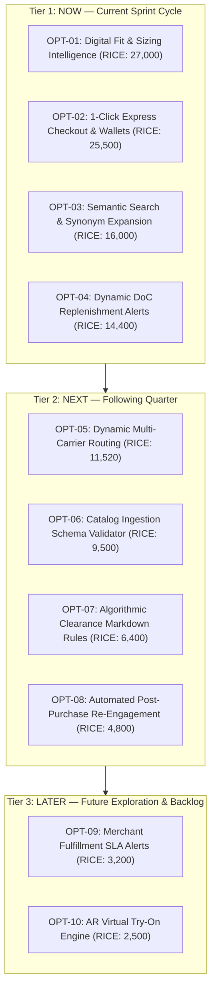

# ThreadIQ — RICE Prioritization Framework & Product Backlog

## 1. Executive Summary & Scoring Methodology

To ensure maximum capital efficiency and engineering focus, ThreadIQ evaluates all product interventions using the **RICE Prioritization Framework**:

$$\text{RICE Score} = \frac{\text{Reach} \times \text{Impact} \times \text{Confidence}}{\text{Effort}}$$

> [!IMPORTANT]
> **Scoring Assumptions & Rubric:**
> - **Reach ($R$)**: Estimated number of affected unique customers, sessions, or orders per calendar quarter.
> - **Impact ($I$)**: Anticipated increase in commercial yield or operational efficiency:
>   - $3.0$ = **Massive** (Direct, company-wide lift on revenue or gross margin)
>   - $2.0$ = **High** (Significant departmental improvement)
>   - $1.0$ = **Medium** (Measurable positive lift)
>   - $0.5$ = **Low** (Minor friction reduction)
>   - $0.25$ = **Minimal** (Incidental benefit)
> - **Confidence ($C$)**: Rigor of underlying evidence:
>   - $1.0$ ($100\%$) = **High Confidence**: Direct quantitative evidence from production database queries, verified operational logs, and validated user research.
>   - $0.8$ ($80\%$) = **Medium Confidence**: Strong directional data from internal metrics and validated industry e-commerce benchmarks.
>   - $0.5$ ($50\%$) = **Low Confidence**: Qualitative assumptions, anecdotal customer feedback, or uncalibrated hypotheses.
> - **Effort ($E$)**: Estimated engineering person-months required for full design, implementation, QA, and deployment (minimum scale: $0.5$).

---

## 2. Exhaustive Opportunity Evaluation Table

The following table scores ten candidate product opportunities derived directly from ThreadIQ's analytical audit:

| Rank | ID | Area | Problem Statement | Proposed Feature | Reach ($R$) | Impact ($I$) | Confidence ($C$) | Effort ($E$) | RICE Score | Backlog Tier | Rationale |
| :---: | :---: | :---: | :--- | :--- | :---: | :---: | :---: | :---: | :---: | :---: | :---: |
| **1** | `OPT-01` | Outbound | 23.2% apparel return rate; 38.5% driven by size & fit issues ($938 refund exposure) | **Digital Fit & Sizing Intelligence Engine** | 25,000 orders | 3.0 | 0.90 (90%) | 2.5 PM | **27,000.0** | **NOW** | Directly attacks the #1 margin leak; high confidence backed by verified return logs. |
| **2** | `OPT-02` | Storefront | 89.0% checkout-to-payment drop-off; 93.3% cart abandonment | **1-Click Express Checkout & Digital Wallets** | 20,000 checkouts | 3.0 | 0.85 (85%) | 2.0 PM | **25,500.0** | **NOW** | Unblocks the highest-intent funnel stage; massive direct GMV lift potential. |
| **3** | `OPT-03` | Storefront | 86.0% zero-result search rate; 14.0% search CTR | **Semantic Search & Dynamic Synonym Expansion** | 15,000 searches | 2.0 | 0.80 (80%) | 1.5 PM | **16,000.0** | **NOW** | Converts dead-end searches into active product views; rapid time-to-market. |
| **4** | `OPT-04` | Inbound | High-velocity SKUs at 4.2 Days of Cover (imminent stockout risk on SKU 1101) | **Dynamic Days of Cover (DoC) Replenishment Alerts** | 12,000 SKU-days | 2.0 | 0.90 (90%) | 1.5 PM | **14,400.0** | **NOW** | Prevents revenue loss on top-selling items; leverages existing inventory snapshot tables. |
| **5** | `OPT-05` | Outbound | Carrier transit represents 75.2% of fulfillment; 30.3% late delivery rate (69.7% OTD%) | **Dynamic Multi-Carrier Routing Engine** | 18,000 shipments | 2.0 | 0.80 (80%) | 2.5 PM | **11,520.0** | **NEXT** | High impact on on-time delivery; requires carrier API integration and SLA routing logic. |
| **6** | `OPT-06` | Inbound | 10% of SKUs missing season and usage metadata, impairing discovery | **Automated Catalog Ingestion Schema Validator** | 5,000 listings | 1.0 | 0.95 (95%) | 0.5 PM | **9,500.0** | **NEXT** | Low effort, high data hygiene return; blocks incomplete supplier batch uploads. |
| **7** | `OPT-07` | Inbound | Slow-moving inventory locking working capital with > 60 Days of Cover | **Algorithmic Clearance Markdown Rules** | 8,000 units | 1.0 | 0.80 (80%) | 1.0 PM | **6,400.0** | **NEXT** | Automates liquidation of stagnant inventory; protects seasonal warehouse capacity. |
| **8** | `OPT-08` | Storefront | 16.7% of customers dormant after first order; 61.1% repeat purchase concentration | **Automated Post-Purchase Re-Engagement Engine** | 6,000 customers | 1.0 | 0.80 (80%) | 1.0 PM | **4,800.0** | **NEXT** | Re-engages dormant buyers with category-specific replenishment recommendations. |
| **9** | `OPT-09` | Outbound | 56.7 hour average seller dispatch; lagging merchants drive cancellations | **Merchant Fulfillment SLA Dashboard & Penalty Alerts** | 4,000 orders | 1.0 | 0.80 (80%) | 1.0 PM | **3,200.0** | **LATER** | Enforces 48-hour dispatch SLAs; merchant portal expansion scheduled for later phase. |
| **10** | `OPT-10` | Storefront | High return rate in Eyewear (50%) and Activewear (60%) | **Augmented Reality Virtual Try-On (AR PDP)** | 10,000 views | 2.0 | 0.50 (50%) | 4.0 PM | **2,500.0** | **LATER** | High technical complexity; requires 3D model asset pipeline and mobile AR SDKs. |

---

## 3. Product Backlog Tiering (Now / Next / Later)

### 3.1 Tier 1: NOW (Immediate Sprint Focus)
1. **`OPT-01`: Digital Fit & Sizing Intelligence Engine** (PRD #1)
   - *Target KPI*: Reduce apparel item return rate from $23.2\%$ to $\le 15.0\%$.
2. **`OPT-02`: 1-Click Express Checkout & Digital Wallets** (PRD #2)
   - *Target KPI*: Increase checkout completion rate from $10.98\%$ to $\ge 25.0\%$.
3. **`OPT-03`: Semantic Search & Dynamic Synonym Expansion** (PRD #3)
   - *Target KPI*: Decrease zero-result search rate from $86.0\%$ to $< 15.0\%$; increase search CTR from $14.0\%$ to $\ge 35.0\%$.
4. **`OPT-04`: Dynamic Days of Cover (DoC) Replenishment Alerts**
   - *Target KPI*: Maintain $\ge 99.5\%$ in-stock availability on core fashion SKUs; prevent stockout on SKU 1101.

### 3.2 Tier 2: NEXT (Planned Subsequent Quarter)
- **`OPT-05`: Dynamic Multi-Carrier Routing Engine**: Improves OTD% from $69.7\%$ to $\ge 90.0\%$.
- **`OPT-06`: Automated Catalog Ingestion Validator**: Attains $100\%$ catalog completeness on mandatory attributes.
- **`OPT-07`: Algorithmic Clearance Markdown Rules**: Reduces overstocked SKUs ($DoC > 60$) by $50\%$.
- **`OPT-08`: Automated Post-Purchase Re-Engagement Engine**: Drives $10\%$ dormant customer reactivation.

### 3.3 Tier 3: LATER (Long-Term Horizon / Exploratory)
- **`OPT-09`: Merchant Fulfillment SLA Dashboard**: Reduces seller dispatch lag below 24 hours.
- **`OPT-10`: AR Virtual Try-On Engine**: Experimental visual fit solution evaluated once 3D assets are established.
