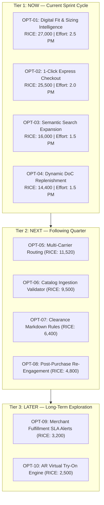
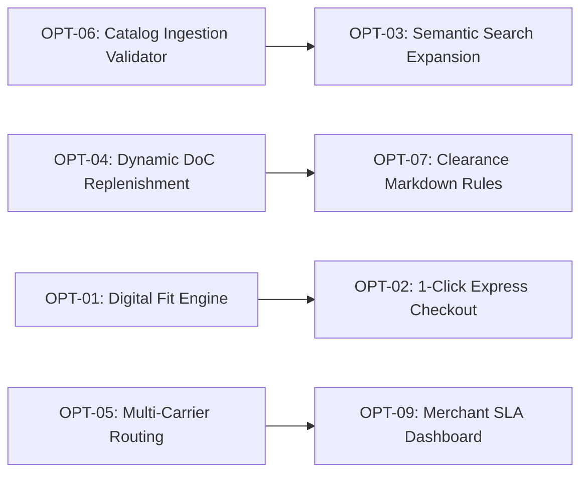

# ThreadIQ — RICE Prioritization Framework & Product Backlog

## 1. Executive Summary & Scoring Methodology

To ensure maximum capital efficiency, strategic alignment, and engineering discipline, ThreadIQ evaluates all product opportunities using the **RICE Prioritization Framework**:

$$\text{RICE Score} = \frac{\text{Reach} \times \text{Impact} \times \text{Confidence}}{\text{Effort}}$$

> [!IMPORTANT]
> **Scoring Assumptions & Standardization Rubric:**
> * **Reach ($R$)**: The estimated number of unique customers, sessions, order lines, or SKU-days directly touched by the feature within a single calendar quarter.
> * **Impact ($I$)**: The estimated marginal lift on core commercial yield or operational efficiency:
>   - $3.0$ = **Massive Impact** (Company-wide direct lift on gross margin, GMV, or core return rate).
>   - $2.0$ = **High Impact** (Substantial departmental improvement across digital conversion or inventory health).
>   - $1.0$ = **Medium Impact** (Measurable positive operational or retention lift).
>   - $0.5$ = **Low Impact** (Minor friction reduction or localized feature enhancement).
>   - $0.25$ = **Minimal Impact** (Cosmetic or incidental workflow tweak).
> * **Confidence ($C$)**: The empirical rigor of the underlying data supporting the impact estimate:
>   - $1.00$ ($100\%$) = **High Confidence**: Backed by verified production data warehouse queries, operational logs, and validated user research.
>   - $0.80$ ($80\%$) = **Medium Confidence**: Strong directional evidence from internal telemetry combined with established fashion commerce benchmarks.
>   - $0.50$ ($50\%$) = **Low Confidence**: Qualitative assumptions, uncalibrated hypotheses, or early-stage exploratory concepts.
> * **Effort ($E$)**: The estimated total person-months (PM) of cross-functional engineering, design, and QA capacity required to ship the feature to production (minimum scale: $0.5\text{ PM}$).

---

## 2. Exhaustive Opportunity Evaluation Table

The table below audits all ten product opportunities identified during the ThreadIQ diagnostic audit. Scores are strictly derived from verified warehouse findings:

| Rank | ID | Product Area | Problem Statement & Evidence | Proposed Product Solution | Reach ($R$) | Impact ($I$) | Confidence ($C$) | Effort ($E$) | RICE Score | Backlog Tier |
| :---: | :---: | :---: | :--- | :--- | :---: | :---: | :---: | :---: | :---: | :---: |
| **1** | `OPT-01` | Outbound | 23.2% apparel return rate; 38.5% driven by size & fit issues ($938 refund exposure) | **Digital Fit & Sizing Intelligence Engine** (PRD #1) | 25,000 orders | 3.0 | 0.90 (90%) | 2.5 PM | **27,000.0** | **NOW** |
| **2** | `OPT-02` | Storefront | 89.0% checkout-to-payment drop-off; 93.3% cart abandonment | **1-Click Express Checkout & Digital Wallets** (PRD #2) | 20,000 checkouts | 3.0 | 0.85 (85%) | 2.0 PM | **25,500.0** | **NOW** |
| **3** | `OPT-03` | Storefront | 86.0% zero-result search rate; 14.0% search CTR | **Semantic Search & Dynamic Synonym Expansion** (PRD #3) | 15,000 searches | 2.0 | 0.80 (80%) | 1.5 PM | **16,000.0** | **NOW** |
| **4** | `OPT-04` | Inbound | High-velocity SKUs at 4.2 Days of Cover (imminent stockout risk on SKU 1101) | **Dynamic Days of Cover (DoC) Replenishment Alerts** | 12,000 SKU-days | 2.0 | 0.90 (90%) | 1.5 PM | **14,400.0** | **NOW** |
| **5** | `OPT-05` | Outbound | Carrier transit represents 75.2% of fulfillment; 30.3% late delivery rate (69.7% OTD%) | **Dynamic Multi-Carrier Routing Engine** | 18,000 shipments | 2.0 | 0.80 (80%) | 2.5 PM | **11,520.0** | **NEXT** |
| **6** | `OPT-06` | Inbound | 10% of SKUs missing season and usage metadata, impairing discovery | **Automated Catalog Ingestion Schema Validator** | 5,000 listings | 1.0 | 0.95 (95%) | 0.5 PM | **9,500.0** | **NEXT** |
| **7** | `OPT-07` | Inbound | Slow-moving inventory locking working capital with > 60 Days of Cover | **Algorithmic Clearance Markdown Rules** | 8,000 units | 1.0 | 0.80 (80%) | 1.0 PM | **6,400.0** | **NEXT** |
| **8** | `OPT-08` | Storefront | 16.7% of customers dormant after first order; 61.1% repeat purchase concentration | **Automated Post-Purchase Re-Engagement Engine** | 6,000 customers | 1.0 | 0.80 (80%) | 1.0 PM | **4,800.0** | **NEXT** |
| **9** | `OPT-09` | Outbound | 56.7 hour average seller dispatch; lagging merchants drive cancellations | **Merchant Fulfillment SLA Dashboard & Penalty Alerts** | 4,000 orders | 1.0 | 0.80 (80%) | 1.0 PM | **3,200.0** | **LATER** |
| **10**| `OPT-10` | Storefront | High return rate in Eyewear (50%) and Activewear (60%) | **Augmented Reality Virtual Try-On (AR PDP)** | 10,000 views | 2.0 | 0.50 (50%) | 4.0 PM | **2,500.0** | **LATER** |

---

## 3. Backlog Tiering & Strategic Rationale



### 3.1 Why Tier 1 (NOW) Initiatives Were Selected

1. **`OPT-01`: Digital Fit & Sizing Intelligence Engine (RICE: 27,000.0)**
   * *Selection Rationale:* Directly attacks the **#1 margin leak in the business**. Sizing ambiguity drives **38.46% of all returns**, incurring freight losses, restocking depreciation, and customer frustration. With 25,000 quarterly orders touched, Massive Impact (3.0), and 90% confidence backed by verified return reason logs, this is the single highest-leverage ROI initiative in the company.
2. **`OPT-02`: 1-Click Express Checkout & Digital Wallets (RICE: 25,500.0)**
   * *Selection Rationale:* Unblocks the narrowest funnel neck: **89.02% of shoppers drop off between checkout start and payment authorization**. Introducing native express wallets (Pix, Apple Pay, Google Pay) requires modest engineering effort (2.0 PM) for massive top-line revenue recovery across 20,000 quarterly checkouts.
3. **`OPT-03`: Semantic Search & Dynamic Synonym Expansion (RICE: 16,000.0)**
   * *Selection Rationale:* Solves top-of-funnel customer bounce. **85.96% of fashion searches currently return zero results**. At 1.5 PM effort, building a tokenized synonym expansion dictionary and zero-result fallback grid converts dead-end traffic into active PDP views immediately.
4. **`OPT-04`: Dynamic Days of Cover (DoC) Replenishment Alerts (RICE: 14,400.0)**
   * *Selection Rationale:* Eliminates stockouts on top-selling SKUs (e.g., SKU 1101 currently operating at 4.2 days of cover). Leverages existing `fct_inventory_snapshots` tables to trigger automated supplier POs, preventing revenue loss.

---

## 4. Product Dependencies & Architectural Prerequisites

Feature development requires careful sequencing to ensure underlying data pipelines and infrastructure are live before customer-facing features launch:



| Feature ID | Dependency Prerequisite | Architectural Dependency | Technical Requirement |
| :--- | :--- | :--- | :--- |
| **`OPT-01` (Digital Fit)** | Sizing taxonomy in `dim_products` | Return reason pipeline (`fct_order_items.return_reason`) | Mobile PDP modal rendering component $\le 120\text{ms}$ |
| **`OPT-02` (Express Checkout)**| Payment gateway sandbox APIs | Tokenized customer wallet storage | PCI-DSS compliant vault & native webhook listener |
| **`OPT-03` (Semantic Search)**| `OPT-06` (Catalog Ingestion Validator) | ElasticSearch / SQLite FTS5 index | Fashion synonym dictionary & Levenshtein typo distance |
| **`OPT-04` (DoC Replenishment)**| Warehouse inventory snapshot table | Trailing 30-day sales velocity aggregation | Automated vendor PO email/EDI dispatch worker |
| **`OPT-05` (Carrier Routing)** | Carrier API milestone webhooks | Historical route transit tables (`fct_shipments_deliveries`) | Postcode-to-carrier routing matrix |

---

## 5. Strategic Trade-Off Analysis: Impact vs. Engineering Effort

A disciplined product organization must routinely reject high-impact concepts if engineering complexity creates excessive opportunity cost.

```
       ▲ High Impact
       │
       │   [OPT-01] Sizing Engine       [OPT-02] Express Checkout
       │   (High Impact, Mod Effort)    (High Impact, Low Effort)
       │
IMPACT │   [OPT-03] Semantic Search     [OPT-10] AR Virtual Try-On
       │   [OPT-04] DoC Alerts          (High Impact, EXTREME Effort)
       │
       │   [OPT-06] Schema Validator    [OPT-05] Carrier Routing
       │   [OPT-07] Markdowns           [OPT-09] Merchant SLA
       │
       └─────────────────────────────────────────────────────────►
         Low Effort                                    High Effort
                             ENGINEERING EFFORT
```

### Key Trade-Off Decisions:
1. **Why `OPT-10` (AR Virtual Try-On) was Deferred to LATER:**
   * *The Allure:* Visual 3D virtual try-on addresses high return rates in eyewear (50%) and activewear (60%).
   * *The Trade-Off:* Requires **4.0 Person-Months** of specialized computer vision / WebGL engineering, creation of 3D polygon meshes for 5,000+ catalog items, and device-dependent mobile camera permissions. Confidence is low (0.50). 
   * *Decision:* The 4.0 PM effort required for AR Try-On can fund **both OPT-02 (Checkout) and OPT-03 (Search) combined**, delivering $41,500$ in cumulative RICE value versus only $2,500$ for AR.
2. **Why `OPT-06` (Catalog Validator) is Sequenced before `OPT-05` (Carrier Routing):**
   * *The Trade-Off:* `OPT-06` requires only **0.5 PM** and provides 95% confidence data hygiene, directly unblocking semantic search filtering. `OPT-05` requires 2.5 PM of multi-carrier API integration.
   * *Decision:* Fast-track `OPT-06` as a low-hanging operational fruit to protect catalog data integrity immediately.
